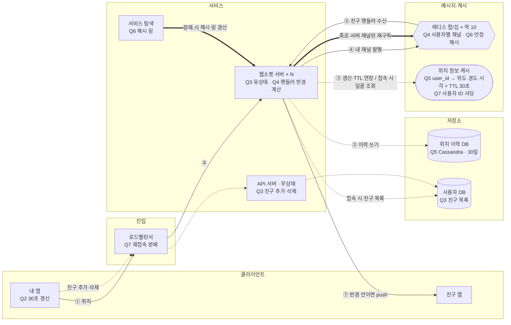

# 2장 주변 친구 — dongjo · S1 동네친구

> **한 줄 요약**: 사용자별 레디스 펍/섭 채널을 친구 전원이 구독하고 구독 측 핸들러가 반경으로 걸러내며, 펍/섭은 안정 해시 + 서비스 탐색으로 나누고, 최신 위치는 레디스 TTL·이력은 Cassandra에 둔다.

## 1. 전제

| 핵심 숫자 | 값 | 계산식 |
|---|---|---|
| 위치 갱신 QPS | 미계산 (식으로만) | 2,000만 × 10% / 30초 |
| 초당 전파 메시지(팬아웃) | 미계산 (식으로만) | 위치 갱신 QPS × 150 × 10% |

- **교재와 다른 제약**: 국내 전용·규모 1/5(친구 150명, 반경 5km), 위치 이력 30일 보관 + opt-in

## 2. 결정 7개

| # | 결정 | 내 선택 | 근거 (한 줄) | 감수한 것 |
|---|---|---|---|---|
| Q1 | 규모 | 식으로 추정, 읽기 위주 | 팬아웃 = QPS × 150 × 10% | 실제 숫자 미계산 |
| Q2 | 갱신 주기·활성 판단 | 30초 고정 / TTL 30초 | 사람 이동은 30초 안에 크게 변하지 않음 | 끊기면 친구가 사라졌다 다시 나타남 |
| Q3 | 통신·서버 구조 | 웹소켓 / API(무상태)·웹소켓(유상태) 분리 / 접속 시 활성 친구 목록, 이후 30초 갱신 | 폴링은 계속 요청을 보내 사용자가 많으면 서버에 부담 | 30초 안 변화는 부정확, 주변에 있었다는 인지면 충분 |
| Q4 ★ | 위치 변경 전파 | 사용자별 레디스 펍/섭 채널, 친구 전원 구독 | 접속 시 TTL로 활성 판단, 메시지 수신 시 핸들러가 반경만 계산 | 비활성 친구 채널도 구독(메모리) |
| Q5 | 위치 저장소 | 레디스 `user_id`→{위도, 경도, 시각} + TTL / 이력은 Cassandra | 키로 바로 꺼냄 / 쓰기가 많고 샤딩이 쉬움 | 30일 보관 방식 미정 |
| Q6 | 펍/섭 클러스터 | CPU 병목, `QPS×150×10%/10만` 대 / 안정 해시 + 서비스 탐색 / 장애 시 살아 있는 서버로 점진 이전 | 해시 링은 노드 추가·삭제가 유연하고 고루 분배 | 3배 피크에 남은 서버 과부하, 재구독 중 유실 |
| Q7 | 웹소켓·캐시 확장 | 내릴 서버가 알리고 클라이언트 재접속 → LB가 다른 서버로 / 캐시는 사용자 ID 샤딩 | 쓰기(갱신)가 무거우니 고르게 분배 | 재접속 폭주, 샤드 복제 미정 |

> 바뀐 결정: Q4 활성·반경 안 친구만 구독 → 친구 전원 구독 (꼬리 질문), TTL 확인은 접속 시에만

## 3. 시스템 전체 설계도

실선 = 위치 갱신 전파 · 점선 = 쓰기·비동기 · 굵은 선 = 돌발 대응

**위치 갱신 → 친구 화면 반영**: ① 앱이 위치 전송 → ② LB가 연결된 웹소켓 서버로 → ③ 위치 캐시 갱신(TTL 연장)·이력 쓰기 → ④ 내 채널에 발행 → ⑤ 구독 중인 친구 핸들러 수신 → ⑥ 핸들러가 반경 계산 → ⑦ 반경 안이면 친구 앱에 push

## 4. 교재와 다르게 간 곳

| 결정 | 교재 | 나 | 이 시나리오에서 왜 |
|---|---|---|---|
| Q1 트래픽 성격 | 쓰기·push 위주 | 읽기 위주 | 근거 미기재 — 미팅에서 확인 |
| Q6 장애 복구 | 대기 노드로 교체, 그 노드 채널만 재구독 | 살아 있는 서버로 점진 이전 | 해시 링이 고루 분배해 줄 것으로 봄 |

## 5. 미팅 안건

- **가장 자신 없는 결정**:
- **같이 이야기할 질문**: 펍/섭이 약 10대뿐인 S1에서, 3배 피크 중 한 대가 죽으면 "살아 있는 서버로 재분배"와 "대기 노드 교체" 중 어느 쪽이 연쇄 장애에 안전한가?
