# 근접성 서비스와 차이점은
- 사업장 주소는 정적이지만, 주변 친구 위치는 자주 바뀔 수 있다.

# 기능 요구사항
- 주변 친구를 확인 할 수 있어야 한다.
	- 해당 친구까지의 거리, 마지막 갱신 시간
- 몇 초마다 목록이 갱신되어야 한다.

# 비기능 요구사항
- 지연 시간이 너무 오래 걸리면 안된다
- 어느 정도의 데이터 유실은 용인 된다.
- 데이터 일관성이 높을 필요는 없다. 사본 데이터가 원본 데이터가 일치하기 까지 몇 초 정도 걸리는건 괜찮다.

# 규모 측정
- 반경 5마일 이내 친구
- 위치 정보는 30초 주기로 갱신
	- 사람이 걷는 속도가 시간당 3~4마일로 추정
- DAU 1억명
- 동접자 -> DAU 의 10%
- 1명당 400명의 친구를 갖는다고 가정
> QPS = 천만 / 30초 =~ 334000

# 대략적 설계안
- 이론적으로는 순수한 P2P로도 가능하다.
	- 하지만
		- 모바일 단말은 통신 연결 상태가 좋지 않은 경우가 있거나
		- 전력이 충분하지 않은 경우도 있다.
- 공용 백엔드로 보완 설계 한다.
	- 활성 상태 A 사용자의 위치 변화 내역을 수신한다.
		- A사용자의 친구(=활성 상태의 모든 친구)들의 단말에 내역을 전달한다.
	- A사용자 지원 반경을 넘어갈 경우 전달하지 않는다.
	- 하지만,
		- 대규모 시스템에서 적용하기 쉽지 않다.
		- 초당 334000(=QPS) x 400(1명당 친구) x 10%(그 중 인근의 활성화 친구) ~= 1400만 건의 위치 정보 갱신 요청 처리가 필요

## 도식화 (resource 이미지 → mermaid)

### 그림 2.5 RESTful API 요청 처리 흐름 (개략적 설계안)
> 원본: `resource/IMG_2605.heic`

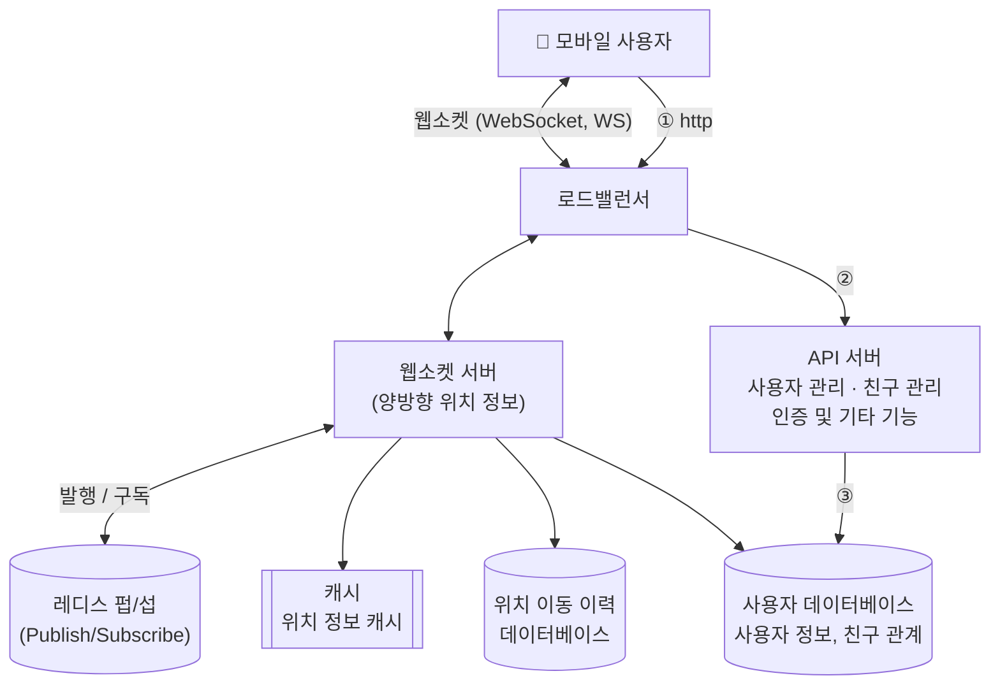

- **API 서버(무상태)**: 친구 추가/삭제, 사용자 정보 갱신 등 부가 작업 (요청/응답)
- **웹소켓 서버(유상태)**: 친구 위치 변경을 거의 실시간으로 처리, 클라이언트는 한 대와 WS 연결 유지

- 캐시 (Redis)
	- 활성 상태 사용자의 가장 최근 위치 정보를 캐시하는데 사용하낟
		- 캐시 항목에는 TTL(Time To Live) 가 있고, 
			- 시간이 지나면 해당 사용자는 비활성 사애로 바뀌고 그 위치 정보는 캐시에서 삭제된다.
			- 배시 정보를 갱신 할 때, TTL도 갱신된다.
- 레디스 펍/섭
	- 초경량 메시지 버스다.
	- 수백만 개의 채널(=토픽)을 생성할 수 있다. (기가바이트급 메모리)

### 그림 2.6 레디스 펍/섭
> 원본: `resource/IMG_2606.heic`

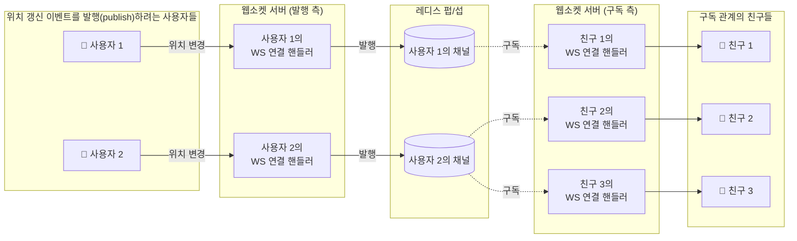

#### 구독 측 연결 핸들러의 처리 (사용자 2의 위치가 바뀐 경우)

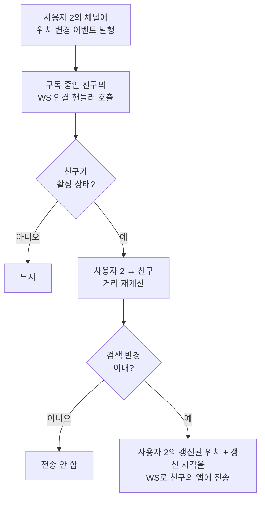

- 사용자마다 **전용 채널** 1개 발행
- 그 사용자의 친구들 과 연결된 WS 연결 핸들러가 해당 채널의 구독자
- 사용자 2가 위치가 변경되면
	- 연결 핸들러가 호출되고
	- 친구가 활성화 상태면
		- 거리를 다시 계산
		- 계산한 거리가 반경 이내이면
			- 사용자 2의 갱신된 위치, 갱신 시각을 친구의 앱으로 보낸다.

### 그림 2.8 친구에게 위치 변경 내역 전송
> 원본: `resource/IMG_2607.heic`
> 가정: 사용자 1의 친구 = 사용자 2, 3, 4 / 사용자 5의 친구 = 사용자 4, 6

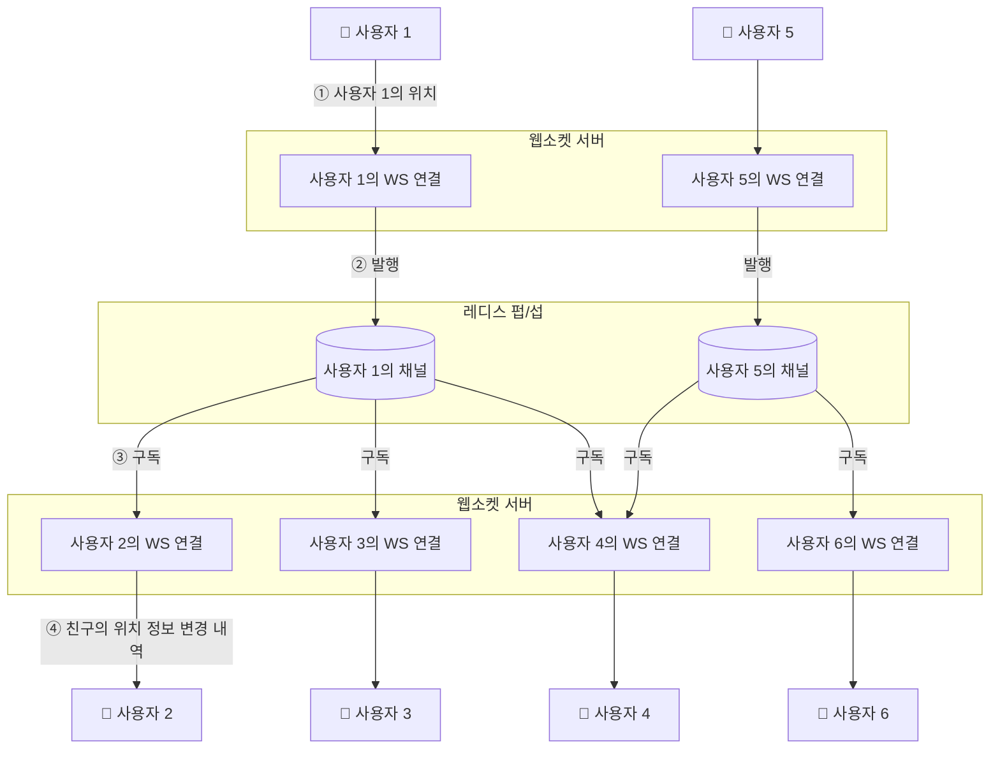

1. 사용자 1의 위치 변경 → 사용자 1과 연결된 웹소켓 서버로 전송
2. 레디스 펍/섭의 사용자 1 전용 채널에 발행
3. 채널 구독자(친구들의 WS 연결 핸들러)에게 브로드캐스트
4. 핸들러가 거리 재계산 → 검색 반경 이내면 갱신된 위치·타임스탬프를 친구 단말에 전송

# API 설계

## 핵심 3줄
1. **위치를 아는 건 단말뿐(GPS)** → 서버는 클라이언트가 보내줘야만 위치를 안다. 그래서 위치 전송 API가 2개다 (접속 시 1번 + 30초마다).
2. **실시간 위치는 웹소켓(WS 서버)**, 그 외 부가 기능(친구 추가/삭제, 프로필)은 **HTTP(API 서버)**.
3. 분류는 "누가 호출하나"가 아니라 **프로토콜 → 메시지 방향**으로 보면 안 헷갈린다.

## API 한눈에 보기

| #   | API         | 프로토콜 | 방향          | 요청       | 응답           | 왜 필요한가                        |
| --- | ----------- | ---- | ----------- | -------- | ------------ | ----------------------------- |
| ①   | 웹소켓 초기화     | WS   | 앱 → 서버      | 위도·경도·시각 | 반경 내 친구들 위치  | 접속 즉시 "활성" 표시 + 첫 화면 친구 목록 계산 |
| ②   | 주기적 위치 갱신   | WS   | 앱 → 서버      | 위도·경도·시각 | 없음           | 30초마다 내 위치를 친구들에게 전파, TTL 연장  |
| ③   | 친구 위치 변경 수신 | WS   | 서버 → 앱 (푸시) | —        | 친구 위치·변경 시각  | 친구가 움직였고 반경 이내일 때만            |
| ④   | 새 친구 구독     | WS   | 앱 → 서버      | 친구 ID    | 친구의 최신 위치·시각 | 친구 추가 후 그 친구 채널 구독            |
| ⑤   | 구독 해지       | WS   | 앱 → 서버      | 친구 ID    | 없음           | 친구 삭제 후 채널 구독 해제              |
| ⑥   | 친구 추가/삭제 등  | HTTP | 앱 → API 서버  | 친구 ID 등  | 성공 여부        | 사용자 DB의 친구 관계 변경 → ④/⑤ 트리거    |

> 원서 표현 "웹소켓 서버가 친구 ID 전송"은 **"웹소켓으로 친구 ID 전송"**의 의미. 실제 시작은 ⑥ 성공 후 앱의 콜백이다.

## 아키텍처 위에서 본 API (그림 2.5 + API 번호)

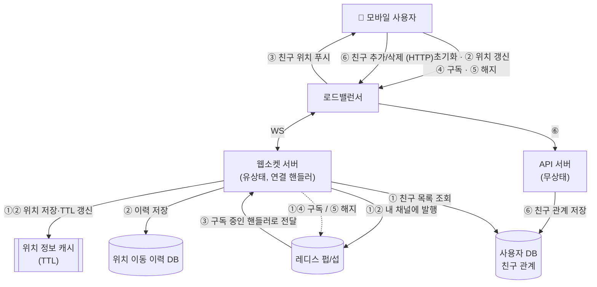

## 흐름 속에서 본 API (시간 순서)

### ① 웹소켓 초기화 — "나 접속했어, 지금 여기야"

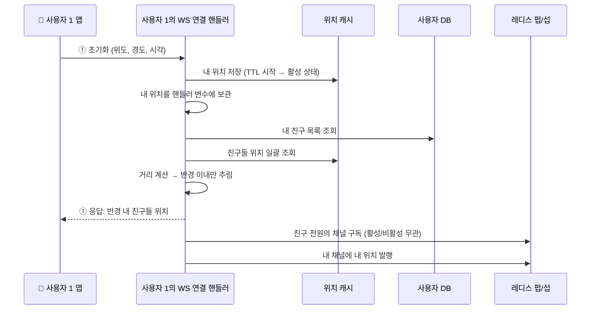

- 핸들러에 보관한 **내 위치**는 이후 ③에서 "친구 ↔ 나" 거리를 계산할 때 쓰인다.

### ② 주기적 위치 갱신 → ③ 친구에게 전달 (그림 2.8 흐름)

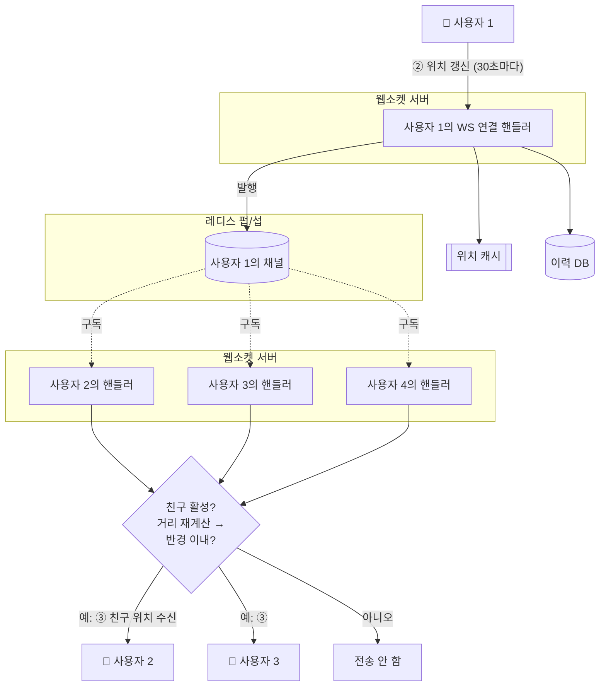

- ②는 응답이 없다 (보내고 끝, 약간의 유실 허용).
- ③은 요청 없이 서버가 **푸시**하는 메시지 → 그래서 "앱이 받는 쪽" API.

### ⑥ 친구 추가 → ④ 새 친구 구독 / 친구 삭제 → ⑤ 구독 해지

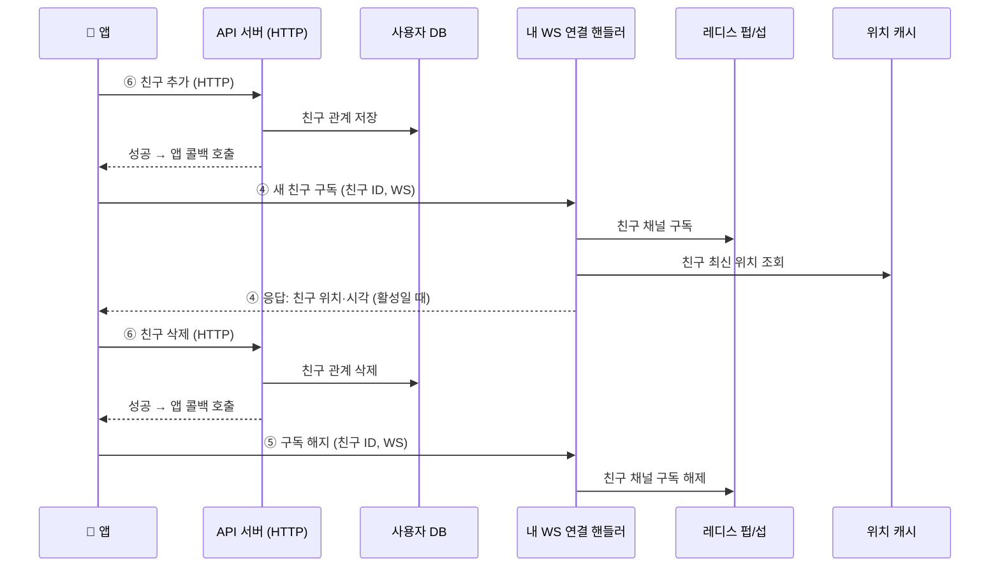

## 정리: 왜 위치를 두 번 보내나?

| | ① 초기화 | ② 주기 갱신 |
|---|---|---|
| 의미 | "나 접속했어, 지금 여기야" | "나 아직 여기 / 이동했어" |
| 횟수 | 접속 시 1번 | 30초마다 반복 |
| 응답 | 반경 내 친구 목록 | 없음 |
| 없으면? | 첫 주기 갱신까지 최대 30초간 빈 화면, 반경 필터 불가 | 친구들이 내 이동을 모름, TTL 만료로 비활성 처리 |

아키텍처 설계
API 서버
- 클서으터의 규모를 CPU 사용률이나 부모, I/ 0 상태에 따라 자동으로 늘리는 방법이다.
- 
- 웹 소켓 클러스터의 사용자률에 따라 규모를 자동으로 늘리는 것은 그다지 어렵지 않다.
	- 단, 단수 API 와는 고려해야할 사항이 있다.

# 클라이언트 초기화

# 사용자 데이터베이스

# 위치 정보 캐시

# 레디스 펍/섭 서버
- 내부 설계
- 메모리 사용량
- CPU 사용량

# 레디스 펍/섭 서버 클러스터
- 서비스 탐색 컴포넌트
	- 설정 데이터를 보관하기 위한 소규모 키-값 저장소
		- 채널을 정할 때 해시 링을 참조한다. [[Q-5)_안정해시]]
			- 메시지를 발행할 채널
			- 구독할 채널
			- 소켓 서버는 메시지를 발행할 레디스 펍/섭 서버를 선정한다.
				- 원래는 서비스 탐색 컴포넌트에 해시링이 보관될 테지만
					- 사본을 웹소켓 서버에 두는것도 방법
						- 대신, 사본과 원본을 동일하게 유지시키는 장치는 해둬야 한다.
				- 메시지는
					- 사용자 위치정보 변경 내역이다. 펍/섭 서버 채널에 발행한다.
	- 펍/섭 서버에서 발생한 변경 내역 구독

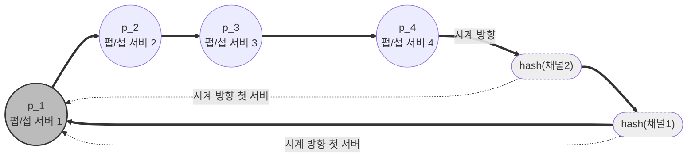
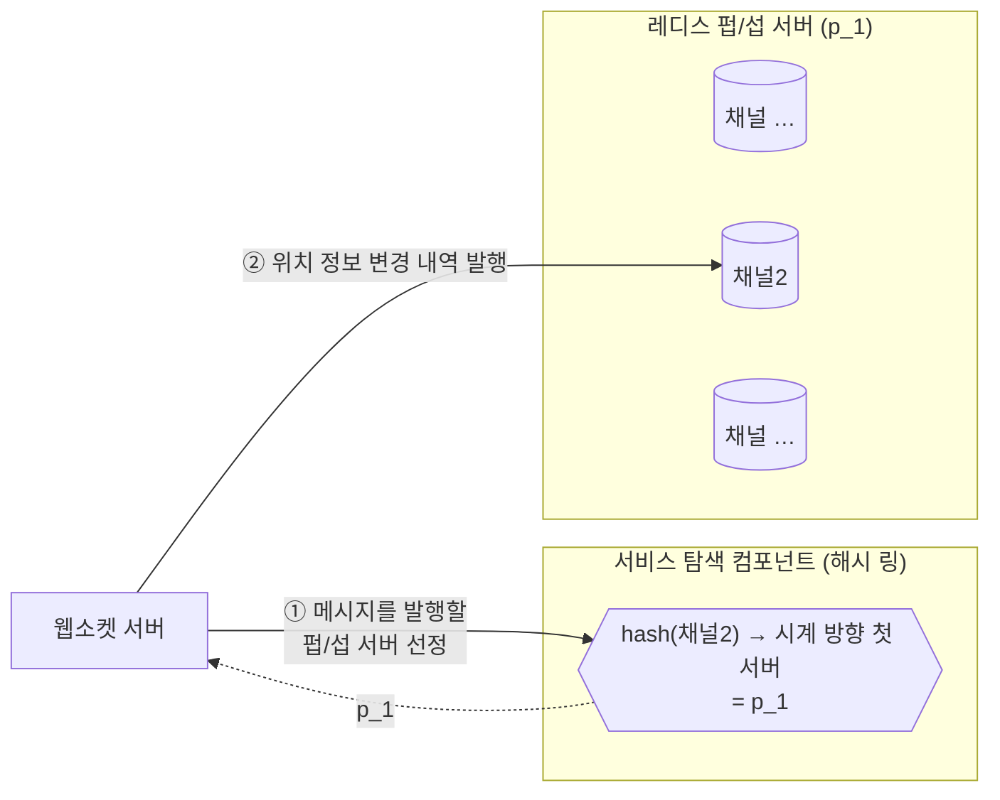

- 규모 확장성 고려
	- 레디스 펍/섭 서버 클러스터의 규모를 늘리려면 어떻게 해야할까?
		- 무상태 서버로 구성된 클러스터 전략 관점
			- 펍/섭 채널에 전송되는 메시지는 메모리, 디스크에 지속적으로 보관되지 않는다
			- 채널의 모든 구독자에게 전송되고 나면 바로 삭제된다.
			- 만약 이 관점이라면, 위험성이 낮고 비용도 절감하기 좋다
		- 유상태 서버로 구성된 클러스터 전략 관점
			- 채널에 대한 상태 정보를 보관한다.
			- 채널에 변경이 필요할 때
				- 채널을 펍/섭 서버를 교체 하거나
				- 해시 링에서 제거해야하는 경우
					- 채널은 다른 서버로 이동 시켜야하고, 해당 채널의 모든 구독자에게 그 사실을 알려야 한다.
					- 구독자가 구독 관계를 해지하고 새 서버에 마련된 새 채널을 구독하도록 한다.
			- 만약 이 관점이라면, 쉽지 않다.
				- 운영 부담과 리스크가 큰 작업이다.
				- 혼잡 시간대 트래픽을 감당하고 불필요한 크기 변화를 피할 수 있도록
					- 오버 프로비저닝을 해야한다.
			- 이런 변화에 대하 리스크를 인지한다면
				- 클러스터 크기를 조정하면, 많은 채널이 같은 해시 링 위의 다른 여러 서버로 이동한다.
					- 이는 엄청난 재구독 요청이 발생할 수 있다.
				- 재구독 요청이 한번에 몰리다 보면, 클라이언트가 보내는 위치 정보 변경 메시지 처리가 누락 될 수 있다.
				- 부하가 가장 낮은 시간대를 골라서 진행해야 한다.
			- 운영 시 고려사항
				- 채널의 대규모 이동 사태를 초래하지 않는 것
				- 교체되는 서버의 채널만 손본다.
					- 서버 장애는 생기게 되어 있고, 그때마다 수시로 대기 서버로 교체한다.
						- 장애 발생 시, 온콜 엔지니어에게 경보가 안내된다.
						- 서비스 컴포넌트의 해시 링에서 장애가 발생한 노드를 대기 중인 노드로 교체한다.
							- 본 노드에 연결되어 있던, 값들을 새 노드로 가르키게 해준다.
						- 교체 사실을 모든 웹소켓 서버에 통지한다.
						- 각 웹소켓 서버는 실행중인 연결 핸들러에게 새로운 펍/섭 서버의 채널을 다시 구독하도록 알린다.
						- 연결 핸들러는 구독 중인 채널 목록을 하나씩 확인하며, 해시 링의 기존 노드로 설정된 관계를 찾아서 새롭게 변경된 채널 노드로 관계를 재 설정한다.

# 그 외 고려
- 친구 추가/ 삭제
	- 새 친구를 추가하면 해당 클라이언트에 연결된 웹소켓 서버의 연결 핸들러에 그 사실을 알려야 한다.
		- 그러면 새친구의 펍/섭 채널을 구독할 수 있게 된다.
	- 새친구가 추가 되면, 호출 될 콜백을 해당 앱에 등록 해 둘 수 있다.
		- 콜벡은 호출 되면 웹소켓 서버로 새 친구의 펍/섭 채널을 구독하라는 메시지를 보낸다.
	- 친구가 삭제되면, 호출 될 콜백을 해당 앱에 등록해둔다.

- 친구가 많은 사용자
	- 맺을 수 있는 친구의 수에 상한이 있다고 가정 (페이스북은 상한 값이 5000)
	- 친구관계 양방향만 취급 (단방향은 배제)
		- 수천 명을 구독하는데 필요한 펍/섭 구독 관계는 클러스터 내의 많은 웹소켓 서버에 분산 됨
			- 친구들의 위치가 변경되는데서 오는 부하는 각 웹소켓 서버가 나누어 처리
			- 핫스팟 문제는 발생하지 않을 것
		- 많은 친구를 둔 사용자의 채널이 존재하는 펏/섭 서버의 경우는 상대적으로 더 많은 부하를 감당하게 될 것
			- 하지만
				- 클러스터 안에 100대 넘는 펍/섭 서버가 있고,  헤비 유저 채널들이 모든 펍/섭 서버에 분산됨
					- 어느정도 부하가 특정 서버에 부담을 크게 주진 않을 것

- 주변의 임의 사용자
	- 주변 사용자들을 무작위로 보여줄 수 있도록 한다면?
	- 지오 해시에 따라 구축된 펍/섭 채널 풀을 두는 것
		- 격자 마다 채널을 하나씩 만들어 둔다.
		- 해당 격자 내의 모든 사용자는 해당 경자에 할당된 채널을 구독한다.
			- 사용자 2의 위치가 변경되면 웹소켓 연결 핸들러는 해당 사용자의 지오해시 ID 를 계산한 다음, 계산된 지오해시 ID 를 담당하는 채널에 사용자 A의 새 위치를 전송한다.
			- 사용자 A가 새롭게 구독하는 채널을 구독하고 있는 그방의 사용자들은 사용자2의 위치가 변경되었다는 메시지를 수신 받는다.
			- 격자 경계 부근에 있는 사용자를 잘 처리하기 위해, 위치한 지오해시 뿐만 아니라 주변 지오해시 격자를 담당하는 채널도 구독한다.

### 그림 2.12 + 2.13 지오해시별 펍/섭 채널 → 주변 사용자에게 위치 전송
> 원본: `resource/IMG_2612.heic` (그림 2.12 지오해시별 펍/섭 채널, 그림 2.13 임의의 주변 사용자에게 위치 변경 내역 전송)

**지도 → 지오해시 격자 (2 x 2)**

| | 왼쪽 | 오른쪽 |
|---|---|---|
| **위** | `9q8zn6` — 사용자 1명 (이름 없음) | `9q8znd` — **사용자 1, 사용자 2, 사용자 3** |
| **아래** | `9q8znf` — 사용자 1명 (이름 없음) | `9q8zn3` — 사용자 2명 (이름 없음) |

- 격자 1개 = 펍/섭 채널 1개 (지오해시 ID가 곧 채널)
- 격자 안의 모든 사용자는 **자기 격자의 채널을 구독**

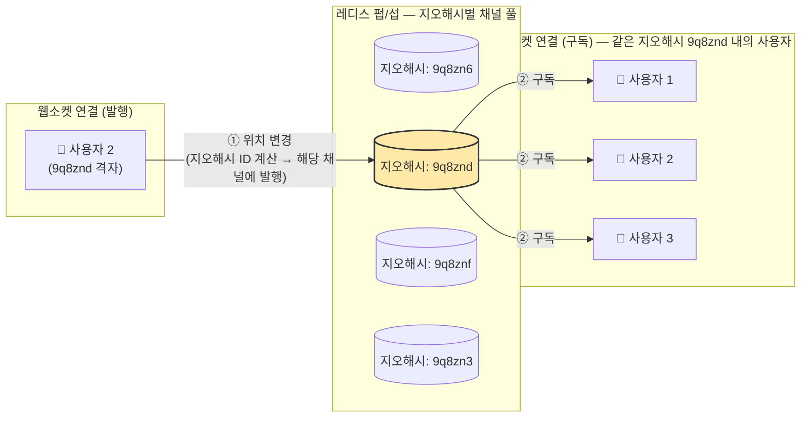

1. 사용자 2의 위치가 바뀌면 → WS 연결 핸들러가 **지오해시 ID(9q8znd)를 계산**해서 그 격자 채널에 발행
2. 9q8znd 채널을 구독 중인 사용자 1, 2, 3이 위치 변경 메시지를 받음 (친구 관계와 무관하게 **같은 격자 = 주변 사용자**)
3. 격자 경계 근처 사용자를 놓치지 않도록, 자기 격자 + **주변 격자 채널도 함께 구독**

- 레디스 펍/섭 외의 대안
	- 얼랭은 레디스 펍/섭 외의 훌륭한 대안이 될 수 있다.
	- 얼랭은 고도로 분산된 병렬 애플리케이션을 위해 고안된 프로그래밍 언어이자 런타임 환경이다.
		- 얼랭의 경량 프로세스는 생성 비용이 매우 저렴하다.
		- 여러 서버로 분산하기 쉽다.
		- 운영 부담이 낮다.
		- 프로덕션에서 발생하는 이슈으 실시간 디버깅을 지원하는 도구들이 많다
	- 구성을?
		- 웹소켓 서비스는 얼랭으로 구현
		- 레디스 펍/섭 클러스터는 아예 분산 얼랭 어플리케이션으로 대체

# 체크 사항
> system-grill S1 동네친구 세션(2026-10-26)에서 헷갈렸던 지점 정리

## 1. TTL은 언제 확인하나? — 접속할 때만

- **① 접속할 때 (초기화, 1회)**
	- 사용자 DB에서 친구 목록 조회
	- 위치 정보 캐시에서 친구들 위치를 **일괄 조회** → TTL이 만료된 친구는 캐시에 **없음** = 비활성
	- **여기서 TTL로 활성 여부를 판단한다**
	- 반경 안 친구만 앱에 보내고, 친구 **전원**의 채널을 구독
- **② 펍/섭 메시지를 받을 때마다 (30초마다 반복)**
	- 메시지 안에 친구의 `{위도, 경도, 시각}`이 들어 있다
	- 발행한 친구는 방금 발행했으니 **지금 활성** → TTL을 다시 볼 필요 없음
	- 받는 쪽(나)은 웹소켓 연결이 살아 있으니 활성
	- 내 위치는 **연결 핸들러가 변수로 들고 있다** → 캐시를 조회하지 않고 메모리에서 **거리만 계산**
	- 반경 안이면 친구 앱으로 전송, 밖이면 버림
- 왜 나누나?
	- 메시지마다 캐시 TTL을 조회하면 팬아웃만큼(S1 기준 초당 약 100만 번) 캐시 읽기가 더 생긴다

## 2. 연결 핸들러와 채널은 1:1인가? — 아니다

| | 사용자당 개수 | 있는 곳 |
|---|---|---|
| 연결 핸들러 | 접속한 사용자마다 1개 | 웹소켓 서버 |
| 채널 | 사용자마다 1개 | 레디스 펍/섭 서버 |

- 둘 다 사용자마다 1개씩인 건 맞지만, 관계는 **방향에 따라 다르다**
	- **발행 (1:1)**: 내 핸들러는 **내 채널 하나**에만 내 위치를 발행
	- **구독 (1:N)**: 내 핸들러는 **친구 전원의 채널**을 구독
	- 채널 기준으로는 반대: 내 채널 하나를 친구 N명의 핸들러가 구독

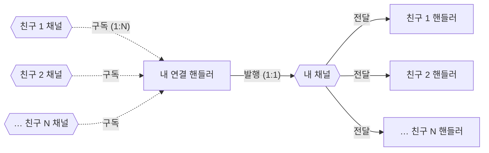

- 그래서 **팬아웃**이 생긴다: 한 번 발행하면 구독자 수만큼 메시지가 복제된다
	- 팬아웃 = 위치 갱신 QPS × 친구 수 × 반경 안 활성 비율
	- 이 숫자가 펍/섭 서버 수(CPU 병목)를 정하는 기준

## 3. 구독 대상은 "친구 전원"인 이유

- 반경 안 / 활성 친구만 구독하면?
	- 반경 밖에 있던 친구 B가 걸어 들어오거나, 비활성 친구가 앱을 켜도 **B의 채널을 구독하지 않았으니 알 방법이 없다**
- 그래서 친구 **전원**을 구독하고, 걸러내는 건 **구독 측 핸들러의 반경 계산**으로 한다
	- 비활성 친구 채널은 메시지가 없어서 **메모리만 조금 쓰고 CPU는 안 쓴다**

## 4. 그 밖에 짚은 것

- **읽기 위주가 아니다**: 팬아웃은 갱신 QPS의 수십 배이고, 이건 서버가 밀어 주는 **쓰기·push**다 → 1장의 "읽기 사본 + 캐시" 방식으로는 받기 어렵다
- **TTL = 갱신 주기(30초)면** 갱신이 한 번만 빠져도 친구가 비활성으로 바뀌어 화면에서 깜빡인다 → 보통 TTL은 주기의 2~3배(60~90초)
- **위치 이력 30일 보관**: Cassandra의 행 TTL(2,592,000초)로 따로 삭제 작업 없이 지킬 수 있다
