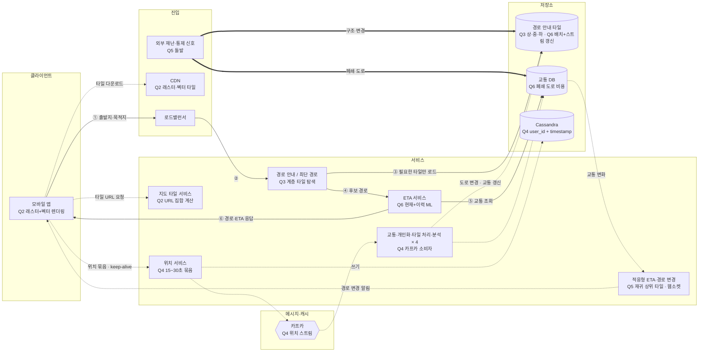

# 3장 구글 맵 — 동조 · S2 월드맵

> **한 줄 요약**: 계층적 경로 안내 타일(상 지방도 / 중 관할구 / 하 도시·주)로 그래프를 쪼개 탐색하고, 위치는 15~30초 묶음으로 Cassandra + 카프카에 흘리며, ETA는 현재+이력 ML로 예측하고, 지진 같은 대규모 단절은 외부 신호로 잡아 타일·교통 DB에 반영한 뒤 웹소켓으로 알린다.

## 1. 전제

| 핵심 숫자 | 값 | 계산식 |
|---|---|---|
| 위치 갱신 QPS (평균 / 피크) | 20만 / 100만 | 50억 분 × 60 / 10⁵ = 300만 → 15초 묶음 ÷ 15 → 피크 × 5 |
| 지도 타일 CDN 초당 전송량 | ≈ 62.5GB/s | 50억 분 × 1.25MB = 6.25PB/일 ÷ 10⁵초 |

- **교재와 다른 제약**: 규모는 교재와 같음. 이동 수단 4종(자동차·도보·자전거·대중교통), 신흥국 사용자가 많아 데이터 요금에 민감

## 2. 결정 6개

| # | 결정 | 내 선택 | 근거 (한 줄) | 감수한 것 |
|---|---|---|---|---|
| Q1 | 규모 | 위치 갱신 피크 100만 QPS, 지도 62.5GB/s | 위치 갱신은 쓰기, 지도는 읽기 → 위치 갱신이 부담 | 받는 계층(CDN vs 위치 서비스) 근거는 진행자 보충 |
| Q2 | 지도 표시·URL | 래스터 + 벡터 조합 / 서버의 지도 타일 서비스가 URL 계산 | 벡터는 압축력이 월등하고 확대가 매끄럽다 / 알고리즘을 클라이언트에 넣으면 버전·업데이트가 골치 아프다 | 조합 기준 미정, 두 벌 운영 / URL 왕복 1회 |
| Q3 ★ | 경로 탐색 | 경로 안내 타일 + 계층(상 지방도 / 중 관할구 / 하 도시·주) | 알고리즘 성능이 그래프 크기에 민감 → 격자로 나눠 그래프로 변환 | 계층 간 갈아타는 시점 미정 |
| Q4 | 위치 갱신·저장 | 15~30초 묶음 + keep-alive / Cassandra(user_id, timestamp) + 카프카로 소비자 분리 | 정체 구간에 1초 전송은 실이 크다 / 쓰기가 많고, 최근 위치·시간대 조회가 빠르다 | 서버가 상황을 최대 15초 늦게 앎 |
| Q5 | 적응형 ETA·경로 변경 | 재귀 상위 타일 저장 / 웹소켓 / 외부 신호로 폐쇄 탐지 (돌발) | 문제 상위 타일에 포함된 사용자만 대상 → 검색 복잡도↓ / 푸시는 크기 제한, 롱 폴링은 부하, SSE는 단방향 | 경로 요청 폭주 미대응 |
| Q6 | 교통 반영·타일 갱신 | ETA는 현재+이력 ML 예측 / 배치 재생성 + 위치 스트림 탐지 조합, 외부 신호는 타일·교통 DB 둘 다 | 도로 상황에 따라 안내가 달라져야 하고, 이동이 불가능한 경로는 제외해야 한다 | 캐시와 이미 계산한 최단 경로의 무효화 방법 미정 |

> 바뀐 결정: Q2 벡터(C) → 조합(D) (꼬리 질문) · Q4 위치 스트림 탐지 + 외부 신호 입력 추가 (돌발)

## 3. 시스템 전체 설계도

실선 = 경로 안내 요청 → 경로·ETA 응답 · 점선 = 쓰기·비동기 · 굵은 선 = 돌발 대응

**경로 안내 요청 → 경로·ETA 응답**: ① 출발지·목적지 전송 → ② 경로 안내 서비스로 전달 → ③ 계층 타일을 필요한 만큼 불러와 탐색 → ④ 후보 경로를 ETA 서비스에 전달 → ⑤ 교통 DB 조회(폐쇄 도로 비용 포함) → ⑥ 경로·ETA 응답

## 4. 교재와 다르게 간 곳

| 결정 | 교재 | 나 | 이 시나리오에서 왜 |
|---|---|---|---|
| Q2 지도 형식 | 미리 만든 래스터 → 벡터로 개선 | 래스터 + 벡터 조합 | 신흥국 저사양 기기의 렌더링 부담 (꼬리 질문 후 변경) |
| Q5 폐쇄 탐지 | 위치 스트림으로 새 도로·폐쇄 도로 탐지 | 외부 신호 입력 추가 | 끊긴 도로는 아무도 안 지나가 스트림만으로는 늦게 안다 |

## 5. 미팅 안건

- **가장 자신 없는 결정**: (미응답)
- **같이 이야기할 질문**: 지진처럼 도로 수백 곳이 한꺼번에 바뀔 때 타일·최단 경로 캐시를 어떻게 무효화해야, 몰려드는 경로 요청이 최단 경로 서비스를 무너뜨리지 않을까?
