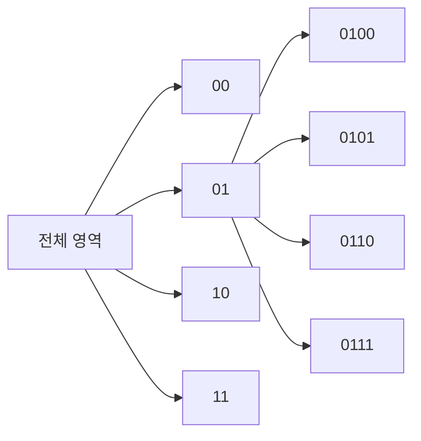
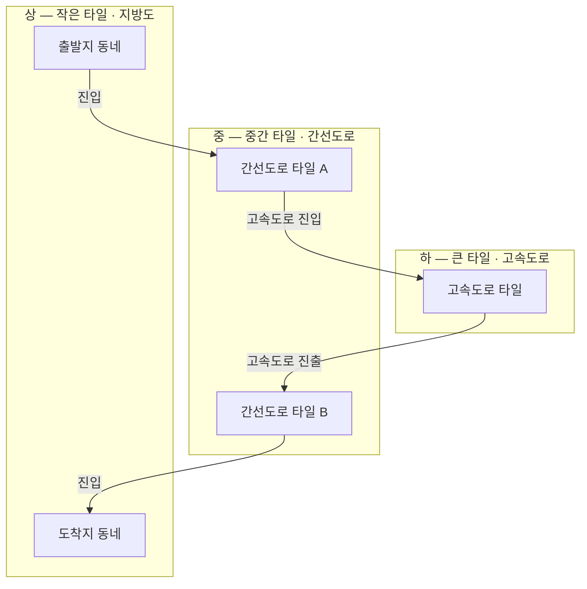
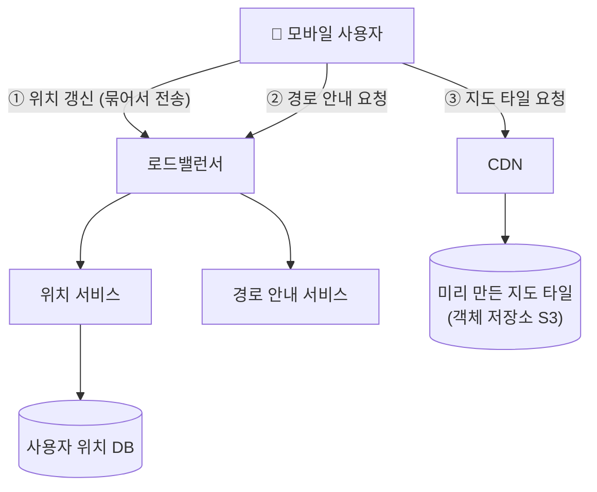
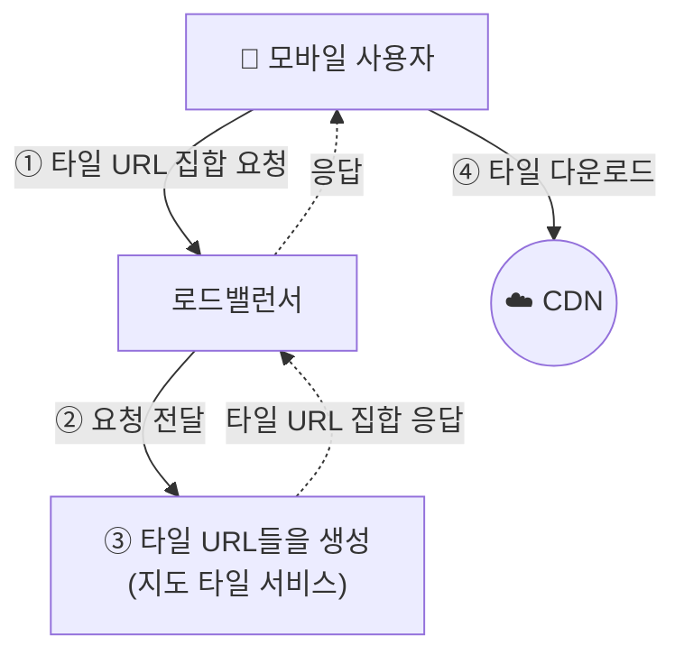
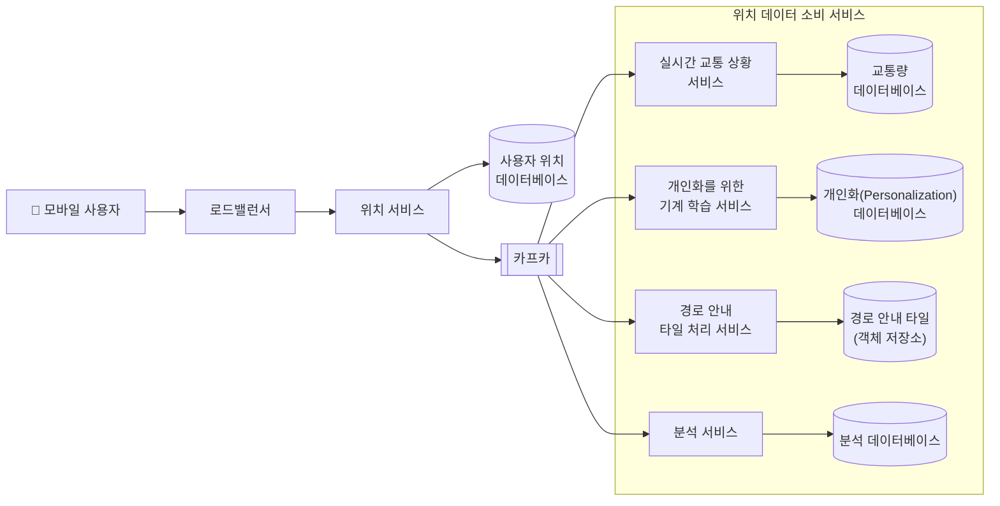
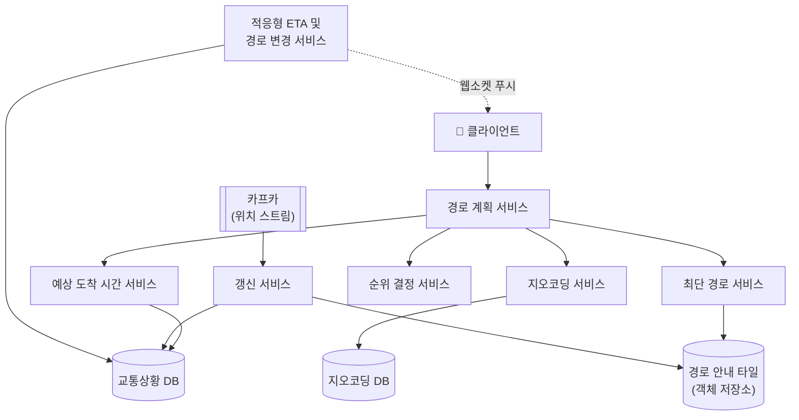

# 앞 장들과 차이점은
- 근접성 서비스(1장)는 **정적인 장소**를, 주변 친구(2장)는 **자주 바뀌는 사용자 위치**를 다뤘다.
- 구글 맵은 거기에 더해 **지도 자체(타일)를 그려 주고**, **도로 그래프 위에서 경로를 계산**하고, **실시간 교통상황으로 ETA를 갱신**해야 한다.

# 1단계 — 문제 이해 및 설계 범위 확정

## 기능 요구사항
- 사용자 위치 갱신
- 경로 안내 서비스 (ETA 포함)
- 지도 표시

## 비기능 요구사항
- **높은 정확성**: 잘못된 경로 안내를 하면 안 된다.
- **부드러운 경로 안내**: 클라이언트에서 지도가 끊기지 않고 부드럽게 표시·확대되어야 한다.
- **낮은 데이터 사용량**: 모바일 데이터와 배터리를 아껴야 한다.

# 규모 추정

## 저장소 사용량

### 세계 지도 (타일)
- 지원하는 확대 수준(zoom level)별로 지도 타일을 **한 벌씩** 두어야 한다.
- BigO 처럼 **최대 확대 수준일 때의 타일 개수**를 따져보면 좋다.
	- 확대할 때마다 타일 1장이 4장으로 쪼개진다고 가정
	- 줌 레벨 21까지 지원 → `4^21 ≈ 4.4조 개`의 타일
	- 타일 1장 = 256 × 256 픽셀 압축 PNG ≈ **100KB**
	- `4.4조 × 100KB ≈ 440PB`
- 지구 표면의 90%는 사람이 살지 않는 지역(바다·사막·산 등)
	- 높은 비율로 압축할 수 있다 → 80~90% 절감
	- `440PB → 44~88PB` → 어림잡아 **50PB**
- 줌 레벨이 한 단계 낮아질 때마다 타일 수가 1/4로 준다
	- `50 + 50/4 + 50/4² + 50/4³ + ... ≈ 50 × 4/3 ≈ 67PB`

### 메타데이터
- 너무 작아서 무시

### 도로 정보
- 외부에서 받은 원본 도로 데이터는 수 TB 로 가정
- 이를 **경로 안내 타일**로 변환한 결과도 비슷한 규모(수 TB)로 추정

## 서버 트래픽

요청은 크게 두 종류
1. **경로 안내 요청** — 출발지·목적지를 보내고 경로를 받는다. (상대적으로 드묾)
2. **위치 갱신 요청** — 경로 안내 중 GPS 좌표를 계속 보낸다. (대부분의 트래픽)

### 위치 갱신 QPS
- DAU 10억
- 1명당 평균 **주당 35분** 경로 안내 사용 → 주당 350억 분 → **하루 50억 분**
- GPS 좌표를 **1초마다** 보낸다면
	- 하루 `50억 분 × 60초 = 3,000억 건`
	- QPS = `3,000억 / 10⁵(하루 ≈ 86,400초) ≈ 300만`
- 클라이언트에서 모아 두었다가 **덜 자주** 보낼 수 있다. (15~30초)
	- 예: 꽉 막힌 도로에서는 위치가 거의 안 바뀌므로 자주 보낼 필요 없다.
	- 15초마다 묶어서 전송한다고 가정
		- QPS = `300만 / 15 = 20만`
		- 최대 QPS = `20만 × 5배(평균의 5배 가정) = 100만`
- 위치 정보는 **실시간 교통상황 데이터 계산의 입력**으로 쓰인다.

> 정정 메모: 처음 메모에서 `3000억 × 10억`, `300만 × 15` 로 적었던 부분을 나눗셈(`÷ 10⁵`, `÷ 15`)으로 바로잡음.

| 핵심 숫자 | 값 | 계산식 |
|---|---|---|
| 지도 타일 저장소 | ≈ 67PB | 4^21 × 100KB × (압축 후 50PB) × 4/3 |
| 위치 갱신 QPS (1초 전송) | ≈ 300만 | 50억 분 × 60 / 10⁵ |
| 위치 갱신 QPS (15초 묶음) | ≈ 20만 | 300만 / 15 |
| 최대 QPS | ≈ 100만 | 20만 × 5 |
| 경로 안내 중 지도 데이터 사용량 | ≈ 1.25MB/분 | 30km/h, 25장 × 100KB = 2.5MB/km² → 75MB/시간 |
| CDN 트래픽 | ≈ 6.25PB/일, 62,500MB/s | 50억 분 × 1.25MB, ÷ 10⁵ |
| POP당 트래픽 | ≈ 300MB/s | 62,500 / 200 POP |

# 2단계 — 개략적 설계안

## 지도 101

### 측위 시스템
- 위도(latitude)·경도(longitude)로 지구 위의 위치를 표현한다.

### 3차원 위치를 2차원으로 변환
- 둥근 지구(3D)를 평면(2D) 지도로 옮기는 과정 = **지도 투영법(map projection)**
- 어떤 투영법이든 왜곡이 생긴다. (웹 지도는 대부분 웹 메르카토르 계열)

### 지오코딩 (Geocoding)
- 주소를 측위 시스템의 **좌표로 변환**하는 프로세스
	- 예: "1600 Amphitheatre Parkway" → `(37.42, -122.08)`
- **역지오코딩**: 좌표를 다시 주소로 변환하는 과정
- **인터폴레이션(interpolation)**
	- GIS(Geographic Information System) 같은 외부 시스템이 제공하는 데이터와 결합
	- 도로망을 지리적 좌표 공간에 대응시킨다.

### 지오해싱 (Geohashing)
- 지도 위 특정 영역을 **영문자와 숫자로 구성된 짧은 문자열**에 대응시키는 인코딩 체계
- 영역을 더 작은 격자로 **재귀적으로 분할**한다.
	- 원하는 크기의 격자가 만들어질 때까지 반복
	- 각 격자에 `00, 01, 10, 11` 번호를 부여 → 분할할수록 비트가 길어진다.
- 구글 맵에서는 **지도 타일을 식별하는 키**로 쓴다.



### 지도 표시 — 타일
- 클라이언트는 사용자가 보려는 영역에 관계된 **타일만 받아 모자이크처럼 이어 붙여** 화면에 그린다.
- 확대 수준마다 **다른 종류의 타일**을 준비해야 한다.
	- 클라이언트가 보려는 확대 수준에 따라 어떤 크기의 타일을 가져올지 고른다.
	- 전 세계를 한눈에 볼 때(줌 0)는 256 × 256 픽셀 이미지 **한 장**만 받으면 된다.

### 경로 안내 알고리즘을 위한 도로 데이터 처리
- 대부분 **다익스트라 또는 A\* 경로 탐색 알고리즘의 변형**이다.
	- 교차로 = 노드, 도로 = 노드를 잇는 간선(edge)인 그래프로 표현
- 알고리즘 성능은 **그래프 크기에 민감**하다.
	- 전 세계 도로망을 하나의 그래프로 두면 메모리도, 탐색 시간도 감당이 안 된다.
- 지오해싱과 비슷한 분할 기술로 작은 격자로 나누고, 각 격자 안의 도로망을 그래프로 변환한다. → **경로 안내 타일(routing tile)**
	- 각 타일은 **도로로 연결된 다른 타일에 대한 참조**를 유지한다.
	- 장점
		- 메모리 요구량이 낮다.
		- 한 번에 처리해야 할 경로의 양이 줄어든다.
		- 필요한 타일만 그때그때 불러오면 된다.

### 계층적 경로 안내 타일
- 경로 안내에는 **필요한 수준의 구체성**이 있어야 한다.
	- 동네 골목까지 가려면 세세한 도로가, 대륙 횡단에는 고속도로만 있으면 된다.
- 구체성에 따라 3계층으로 나눈다.

| 계층 | 타일 크기 | 다루는 도로 |
|---|---|---|
| 상 | 아주 작음 (구체성 가장 높음) | 지방도 (동네 도로) |
| 중 | 상보다 넓은 지역 | 관할구를 잇는 간선도로 |
| 하 | 가장 넓은 지역 | 도시·주를 잇는 주요 고속도로 |



- 장거리 경로는 출발지·도착지 근처만 "상" 타일로 보고, 중간은 "하" 타일(고속도로)로 건너뛴다. → 탐색 그래프가 크게 줄어든다.

## 개략적 설계안



### 위치 서비스
- 사용자의 위치를 기록한다.
- 클라이언트는 `t` 초마다 위치를 보내되, 이력을 **모아서 한 번에** 보낸다. (위 15초 가정)
- API: `POST /v1/locations` — 파라미터 `locs`: `(위도, 경도, 시각)` 배열의 JSON
- 쓰기가 압도적으로 많으므로 **쓰기에 강하고 수평 확장이 쉬운 DB**(예: 카산드라)가 적합하다.
- HTTP **keep-alive** 옵션과 함께 사용해 연결 비용을 줄인다.
	- 💭 왜 웹소켓이 아니라 HTTP일까? 결국 연결을 유지한다는 점에서 효과는 비슷할 텐데 — 미팅에서 논의해 볼 것
- 장점: 위치 **데이터 스트림**으로 시스템을 점차 개선할 수 있다.
	- 실시간 교통 상황 모니터링, 폐쇄된 도로 탐지, 개인화된 경험 제공
	- 거의 실시간 위치이므로 **ETA를 더 정확히** 산출하고, 교통 상황에 따라 **다른 경로**를 안내할 수 있다.

### 경로 안내 서비스
- 출발지 → 목적지의 **합리적으로 빠른 경로**를 찾는다. (정확도가 보장되어야 한다)
- API: `GET /v1/nav?origin=...&destination=...`
- 응답: 거리, 소요 시간, 경로(polyline), 단계별 안내 등

#### 참고 — 실제 구글 Routes API (`computeRoutes`)
- 구글의 Directions API는 **Routes API**로 마이그레이션되었다.
- 책의 `GET` 방식과 달리 **`POST` + JSON 본문**, 응답 필드를 고르는 **필드 마스크(`X-Goog-FieldMask`)가 필수**다.

```http
POST https://routes.googleapis.com/directions/v2:computeRoutes
X-Goog-Api-Key: YOUR_API_KEY
X-Goog-FieldMask: routes.duration,routes.distanceMeters,routes.polyline.encodedPolyline

{
  "origin":      { "location": { "latLng": { "latitude": 37.419734, "longitude": -122.0827784 } } },
  "destination": { "location": { "latLng": { "latitude": 37.417670, "longitude": -122.079595 } } },
  "travelMode": "DRIVE",
  "routingPreference": "TRAFFIC_AWARE",
  "computeAlternativeRoutes": false,
  "routeModifiers": { "avoidTolls": false, "avoidHighways": false, "avoidFerries": false },
  "languageCode": "ko-KR",
  "units": "METRIC"
}
```

```json
{
  "routes": [
    {
      "distanceMeters": 772,
      "duration": "165s",
      "polyline": { "encodedPolyline": "ipkcFfichVnP@j@BLoFVwM{E?" }
    }
  ]
}
```

| Route 필드 | 설명 |
|---|---|
| `distanceMeters` | 총 거리(m) |
| `duration` / `staticDuration` | 교통 상황 반영 / 미반영 소요 시간 (`"165s"`) |
| `polyline` | 전체 경로 선 (`encodedPolyline` 또는 `geoJsonLinestring`) |
| `legs[]` | 지점 사이 구간 — `distanceMeters`, `duration`, `polyline`, `startLocation`, `endLocation`, `steps[]` |
| `legs[].steps[]` | 회전 단위 안내 — `distanceMeters`, `staticDuration`, `polyline`, `navigationInstruction`(`maneuver`, `instructions`), `travelMode` |
| `viewport` | 경로 선을 감싸는 영역 (`low`/`high`) |
| `travelAdvisory` | 통행료, 구간별 교통 속도 등 |
| `localizedValues` | 사람이 읽는 텍스트 ("12분", "3.4km") |
| `routeLabels[]` | `DEFAULT_ROUTE`, `DEFAULT_ROUTE_ALTERNATE`, `FUEL_EFFICIENT` |
| `optimizedIntermediateWaypointIndex[]` | 최적화된 경유지 순서 |

- 책의 3단계 구성과 맞춰 보면 `duration`(교통 반영) = **ETA 서비스**, `staticDuration`·`polyline` = **최단 경로 서비스**, `routeLabels`·대안 경로 = **순위 결정 서비스**의 결과에 대응한다.

### 지도 표시
- 클라이언트가 보는 **확대 수준에 따라 필요한 타일만** 서버에서 가져온다.
- 사용자 시나리오
	- 지도를 확대·이동하며 주변을 탐색한다.
	- 사용자 위치가 현재 타일을 벗어나 **인접 타일로** 넘어간다.

| | 선택지 1 — 즉석 생성 | 선택지 2 — 미리 만든 타일 ✅ |
|---|---|---|
| 방식 | 요청마다 서버가 타일을 동적으로 그림 | 확대 수준별로 미리 만든 타일을 전달 |
| 문제/장점 | 서버 클러스터에 **심각한 부하**, 캐시 어려움 | 정적 데이터라 **캐시·규모 확장 용이**, 성능 유리 |
| 저장 | — | 원본은 객체 저장소, 사본은 **CDN** |

- 사람들은 **같은 길을 일상적으로** 다니므로, **클라이언트에도 캐시**를 두면 데이터 사용량을 크게 줄일 수 있다.

#### 데이터 사용량 · CDN 트래픽 추정
- 사용자가 **30km/h**로 이동, 타일 1장 = **200m × 200m** 영역 (256 × 256 픽셀, 평균 100KB)
	- 1km × 1km 영역 = `(1km × 1km) / (200m × 200m)` = **25장** = `25 × 100KB` = **2.5MB**
	- 시간당 `30 × 2.5MB = 75MB` → 분당 **1.25MB**
- CDN 트래픽
	- 하루 50억 분 경로 안내 → `50억 × 1.25MB = 6.25PB/일`
	- 초당 `6.25PB / 10⁵초 ≈ 62,500MB/s`
	- 전 세계 POP 200개 가정 → POP당 `62,500 / 200 ≈ 300MB/s`

> 정정 메모: 처음 메모의 `6.25PB / (10억 DAU / 24시간 × 60분 × 60초)` 는 `6.25PB / 하루 초 수(≈10⁵)` 로 바로잡음.

#### 타일 URL은 어디서 계산하나?
- 클라이언트 위치 + 확대 수준 → 화면에 대응되는 타일의 **지오해시** 계산 → `https://cdn.map-provider.com/tiles/9q9hvu.png`

| 계산 위치 | 장점 | 단점 |
|---|---|---|
| 클라이언트 | 서버 왕복 없음 | 지원 플랫폼이 많으면 알고리즘을 모두 맞춰야 함, 인코딩 방식(지오해시)을 오래 바꾸기 어려움 |
| 서버 (지도 타일 서비스) | 인코딩 방식을 한곳에서 바꿀 수 있음 | 타일 URL 요청 1회가 더 필요 |

- 서버 방식: 위도·경도 + 확대 수준을 **타일 URL 집합으로 변환**하는 별도 서비스를 둔다. (그림 3.12)



# 3단계 — 상세 설계

## 데이터

| 데이터 | 특징 | 저장소 |
|---|---|---|
| 경로 안내 타일 | 도로 데이터를 주기적으로 변환한 결과, 인접 리스트 형태 | 객체 저장소(S3) + 경로 탐색 서비스에서 캐시 |
| 사용자 위치 | 쓰기 매우 많음, 교통상황·학습에 사용 | 카산드라 (`user_id`, `timestamp` 키) |
| 장소 (지오코딩 DB) | 읽기 빈번, 쓰기 드묾 | 레디스 같은 키-값 저장소 |
| 미리 생성한 지도 이미지 | 정적, 대용량 | 객체 저장소(S3) + CDN |

- **경로 안내 타일 처리 서비스**: 외부 도로 데이터를 받아 오프라인 파이프라인으로 경로 안내 타일을 만든다. 도로 데이터가 바뀌면 주기적으로 다시 만든다.
	- 원본: 외부 사업자·기관이 제공하는 방대한 도로 + 메타데이터(이름, 관할구, 위도·경도 등) → 그대로 쓰기 어려워 변환한다.
	- 다른 타일의 도로와 연결되면 그 타일에 대한 **참조**도 포함한다.
- **경로 안내 타일은 왜 객체 저장소에?**
	- **인접 리스트**로 직렬화해 S3에 두고 **지오해시 기준으로 분류**한다.
	- 메모리에 두기엔 양이 너무 많고, DB에 넣기엔 비용이 아깝고 DB 기능을 쓸 일이 없다.
	- 직렬화한 인접 리스트를 **지역 캐시**에 올려 빠르게 서빙한다.
- **장소(지오코딩 DB)**: 주소 → 위도·경도 쌍을 보관. 읽기가 빈번하고 쓰기는 드물어 **빠른 읽기**에 강한 레디스가 적합하다.
- **미리 생성한 지도 이미지**: 인근 정보를 취합해 **모든 도로와 도로 상세 정보**가 담긴 이미지를 만든다. 한 번만 생성하고 결과를 캐싱한다.
	- 💭 도로 공사·폐쇄, 건물 위치 등이 바뀌면 **변경은 어떻게 감지**하나? **캐시 갱신 주기**는? — 미팅에서 논의해 볼 것

## 서비스

### 위치 서비스 — 데이터베이스 설계
- **쓰기 연산에 탁월한 DB**: NoSQL 키-값 DB 또는 열 중심(column-oriented) DB
- **CAP 정리**에서 무엇을 고르나?
	- 일관성(Consistency), 가용성(Availability), 분할 내성(Partition tolerance) 중 둘만 만족시킬 수 있다.
	- 사용자 위치는 금방 바뀌므로 **이전 데이터는 쓸모가 없다** → 일관성보다 **가용성**이 중요
	- → **AP** 선택: 높은 가용성을 보장하면서, 규모 확장을 위한 분할 내성을 만족시킨다. (카산드라가 적합)

| 구분 | 컬럼 | 역할 |
|---|---|---|
| 키 | `user_id` | **파티션 키** |
| 키 | `timestamp` | **클러스터링 키** |
| 값 | `lat`, `long` | 위도·경도 |
| 값 | `user_mode` | 사용자 활성화 상태 |
| 값 | `driving_mode` | 이동 모드 |

- 같은 파티션 키를 가진 데이터는 **함께 저장되고 클러스터링 키(시각)로 정렬**된다.
	- 특정 사용자의 **최근 위치**를 빠르게 읽을 수 있다.
	- 특정 **시간 범위의 위치**도 효율적으로 읽을 수 있다.

### 위치 서비스 — 위치 데이터는 어떻게 이용되는가
- 활용처
	- 새로 개설되었거나 **폐쇄된 도로 감지**
	- 지도 데이터 **정확성을 점진적으로 개선**하는 입력
	- **실시간 교통 현황** 파악
- 위치 데이터를 DB에 쓰는 것과 동시에 **카프카 같은 메시지 큐로 스트리밍**한다.
- 여러 소비자가 같은 스트림을 각자 목적에 맞게 쓴다.
	- 실시간 교통 상황 서비스 → 실시간 교통량 DB 갱신
	- 경로 안내 타일 처리 서비스 → 새 도로·폐쇄 도로 탐지 → 객체 저장소의 경로 안내 타일에 반영



### 지도 표시

| 확대 수준 | 타일 개수 | 합친 해상도 |
|---|---|---|
| 0 | 1 (세계 전체) | 256 × 256 |
| 1 | 2 × 2 | 512 × 512 |
| 2 | 4 × 4 | 1024 × 1024 |
| n | 2ⁿ × 2ⁿ | 256·2ⁿ × 256·2ⁿ |

- **미리 만들어 둔 타일(래스터 이미지)**
	- 확대 수준별 지도 타일을 미리 만들어 둔다. 구글 맵은 **21단계** 확대를 지원한다.
	- 한 단계 올릴 때마다 타일 수는 **동서 방향 2배 × 남북 방향 2배**, 타일 크기는 항상 256 × 256

	- 단순하고 CDN 캐시에 유리하다.
	- 대신 확대할 때 픽셀이 깨지고, 확대 단계 사이 전환이 부드럽지 않다.
- **벡터 타일 사용**
	- **WebGL** 기술을 채택해, 이미지 대신 경로(path)·다각형(polygon) 같은 **벡터 데이터**를 보내고 클라이언트가 직접 그린다.
	- 이미지보다 압축률이 월등해 **데이터 사용량이 적다.** (비기능 요구사항: 낮은 데이터 사용량)
	- 확대·회전이 **매끄럽다.** (비기능 요구사항: 부드러운 경로 안내)

### 경로 안내 서비스



- **지오코딩 서비스**
	- 주소 → 좌표(위도·경도) 변환. 출발지·목적지가 주소로 들어오면 먼저 거친다.
- **경로 계획 서비스**
	- 현재 교통상황·도로 상태를 반영해 **최적화된 경로**를 계산하는 오케스트레이터
	- 아래 서비스들을 순서대로 호출한다.
- **최단 경로 서비스**
	- 출발지·도착지 좌표로 **상위 k개의 최단 경로**를 반환한다.
	- 교통상황은 고려하지 않는다. → 도로 구조는 자주 안 바뀌므로 **결과 캐싱이 유리**
	- A\* 변형을 **경로 안내 타일** 위에서 수행 (필요한 타일만 로드, 계층 타일 활용)
- **예상 도착 시간(ETA) 서비스**
	- 후보 경로별 소요 시간 계산
	- 현재 교통상황 + 과거 데이터로 **앞으로의 교통상황을 기계학습으로 예측**
- **순위 결정 서비스**
	- 사용자 필터(유료도로 회피, 고속도로 회피 등)를 적용하고 ETA 기준으로 순위를 매겨 **상위 k개**를 반환
- **갱신 서비스**
	- 카프카의 위치 스트림을 소비해 **교통상황 DB**와 **경로 안내 타일**을 비동기로 갱신
- **적응형 ETA 및 경로 변경 서비스**
	- 경로 안내 중인 **활성 사용자를 추적**하고, 교통상황이 바뀌면 ETA·경로를 다시 계산해 알린다.
	- 문제: "어떤 사용자가 이 교통 변화의 영향을 받나?"를 빨리 찾아야 한다.
		- 단순 방식: 사용자별로 경로에 포함된 **모든 상 계층 타일**을 저장 → 타일 하나 바뀔 때 전 사용자 목록을 훑어야 해서 비효율적
		- 개선: 경로가 지나는 타일 + 그 타일을 포함하는 **상위 계층 타일**까지 저장
			- 변화가 생긴 타일이 사용자의 **가장 큰(하 계층) 타일 안에 있는지**만 먼저 보면 대부분 빠르게 걸러낸다.
	- 클라이언트로 푸시하는 방식
		- 모바일 푸시 알림: 페이로드 크기 제한(iOS 4KB 등), 웹 미지원
		- 롱 폴링 / SSE: 가능하지만
		- **웹소켓**: 양방향·가벼움 → 서버에서 즉시 밀어주기에 적합 (2장과 같은 선택)

# 그 외 고려
- 경로 안내 중간에 **경유지 추가** 같은 기능 확장
- 교통 데이터 외 **날씨, 사고, 공사** 정보 반영
- 경로 안내 타일은 오프라인 생성 → 실시간 도로 변화는 갱신 서비스가 보정

# 체크 사항

## 1. 왜 타일을 서버에서 그리지 않나? — 미리 만들어 CDN으로
- 동적 렌더링은 서버 부하가 크고 캐시가 어렵다.
- 타일은 정적이고 같은 지역을 많은 사람이 보므로 **CDN 캐시 효율**이 매우 높다.

## 2. 경로 탐색은 왜 타일로 쪼개나? — 그래프 크기 때문
- 다익스트라/A\* 는 그래프 크기에 민감 → 전 세계 그래프 한 번에는 불가능
- 필요한 타일만 로드 + 장거리는 상위 계층 타일로 건너뛰기

## 3. 위치 갱신은 왜 묶어서 보내나? — QPS·배터리
- 1초 전송 시 300만 QPS → 15초 묶음으로 20만 QPS
- 클라이언트 입장에서도 **데이터 사용량·배터리**를 아낀다.

## 4. 최단 경로와 ETA를 왜 분리하나? — 변하는 속도가 다르다
- 도로 구조(최단 경로)는 거의 안 변함 → 캐시
- 교통상황(ETA)은 계속 변함 → 실시간 계산

## 5. 타일 URL(지오해시)은 클라이언트가 계산하나, 서버가 계산하나? — 변경 비용
- 클라이언트 계산: 왕복이 줄지만 플랫폼마다 구현해야 하고 인코딩 방식을 바꾸기 어렵다.
- 서버 계산(지도 타일 서비스): 요청 1회가 늘지만 인코딩 방식을 한곳에서 바꿀 수 있다.

## 6. 사용자 위치 DB는 왜 AP인가? — 오래된 위치는 쓸모없다
- 위치는 금방 갱신되므로 약간의 불일치보다 **쓰기 가용성**이 중요하다.
- `user_id`(파티션 키) + `timestamp`(클러스터링 키)로 최근 위치·기간 조회가 빠르다.

<!-- answer-pr 테스트용 수정 (삭제 예정) -->
<!-- test2 -->
<!-- test3 -->
<!-- test4 -->
