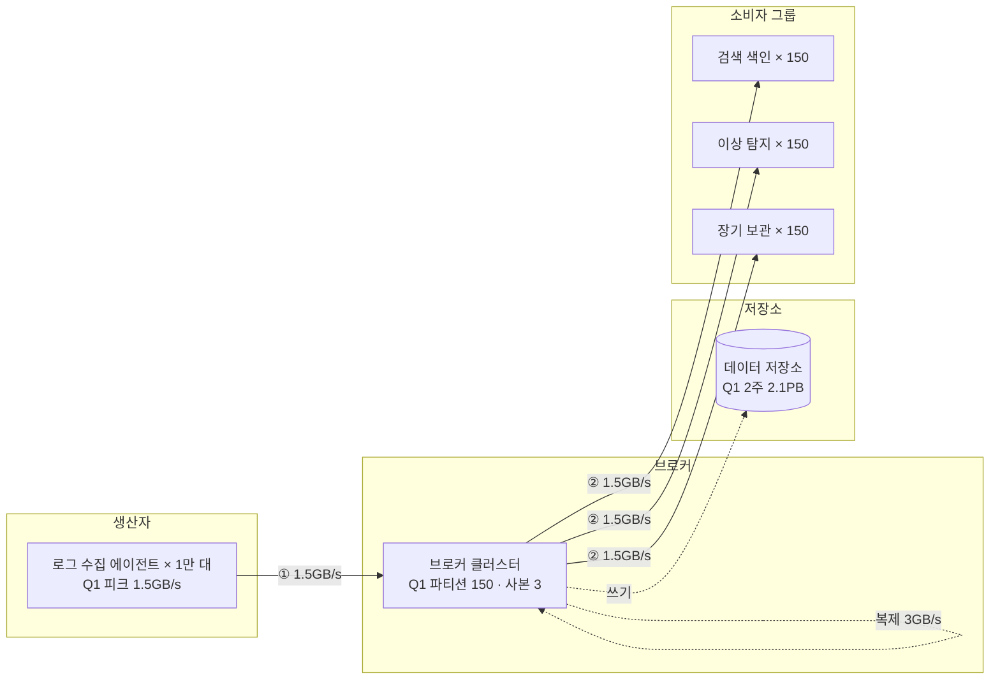

# ch04 미팅과제

> 시나리오: **S1 로그창고** · system-grill 세션(2026-11-08)에서 Q1까지 진행

> **한 줄 요약**: 피크 1.5GB/s 로그를 파티션 150개로 받되, 복제와 소비자 그룹 3개 때문에 브로커를 오가는 총량이 9GB/s가 되어 네트워크 대역폭이 가장 먼저 한계에 닿는다. (Q2~Q4는 시간 관계로 미진행)

## 1. 전제

| 핵심 숫자 | 값 | 계산식 |
|---|---|---|
| 피크 쓰기 처리량 | 1.5GB/s (150만 건/s) | 50만 건/s × 1KB × 3 |
| 필요한 파티션 수 | 150 | 쓰기 1,500MB ÷ 10MB = 150 / 읽기 150만 건 ÷ 1만 건 = 150 → 큰 값 150 |
| 2주 보관 저장 용량 | 2.1PB | 500MB/s × 10⁵초 = 50TB/일 × 14일 × 사본 3개 |

- **교재와 다른 제약**: 로그 일부(0.1% 이하) 유실 허용, 대신 생산자(서비스 서버)가 느려지면 안 됨

## 2. 결정 4개

| # | 결정 | 질문 | 내 선택 | 근거 (한 줄) | 감수한 것 |
|---|---|---|---|---|---|
| Q1 | 규모 | 피크 처리량·2주 저장 용량·파티션 수는? 무엇이 먼저 한계에 닿나? | 피크 1.5GB/s(150만 건/s), 하루 50TB, 2주 2.1PB, 파티션 150 / B) 네트워크 대역폭 | 복제 3GB + 소비자 그룹 3개 4.5GB까지 브로커를 오가는 총량 9GB/s, 일괄 처리는 요청 횟수만 줄이고 총량은 그대로 | — |
| Q2 | 파티션 키·생산자 일괄 처리 | ① 로그를 150개 파티션 중 어디에 넣나? ② 에이전트는 로그를 어떻게 보내나? | 미진행 | | |
| Q3 ★ | 복제와 ACK | 사본은 몇 개를 어디에 두고, 생산자는 언제 ACK를 받나? | 미진행 | | |
| Q4 | 소비 방식·전달 보장 | (돌발: 장애로 로그 10배, 이상 탐지 lag 20분) ① 소비자는 어떻게 받나? ② 오프셋은 언제 커밋하나? | 미진행 | | |

## 3. 전체 설계도

실선 = 메시지 발행 → 소비 · 점선 = 쓰기·비동기 · 굵은 선 = 돌발 대응(미진행)

**메시지 발행 → 소비**: ① 에이전트 → 브로커(파티션 150) → ② 소비자 그룹 3개가 각자 전부 읽어 감 (Q2~Q4 미진행으로 버퍼·ACK·오프셋 단계는 비움)

## 4. 교재와 다르게 간 곳

교재와 같음 (교재는 규모 숫자를 주지 않음. 진행한 Q1 범위에서 다르게 간 곳 없음)

## 5. 미팅 안건

- **가장 자신 없는 결정**:
- **같이 이야기할 질문**: 브로커를 오가는 9GB/s 중 가장 큰 몫은 소비자 그룹 3개의 읽기(4.5GB/s)다. 사본 수, 소비자 그룹 수, 압축 중 무엇을 먼저 손대야 할까?
