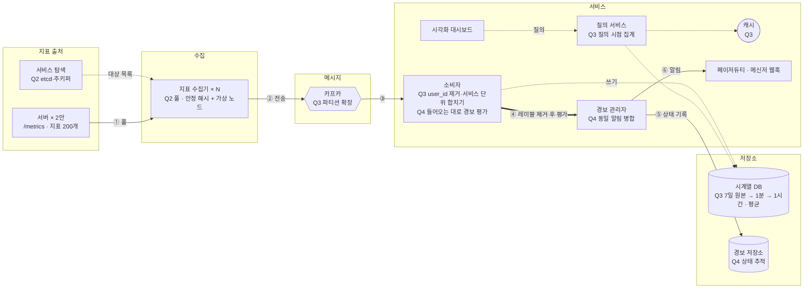

# ch05 미팅과제

> 시나리오: **S1 사내서버** · system-grill 세션(2026-11-15)에서 Q1~Q4 진행

> **한 줄 요약**: 서버 2만 대 지표(초당 40만 포인트)를 풀 + 안정 해시(가상 노드)로 모아 카프카로 받고, 돌발 때는 카프카 소비자에서 `user_id` 레이블을 떼어 합치고 경보도 들어오는 대로 평가해 시계열 DB 질의 지연을 피한다.

## 1. 전제

| 핵심 숫자 | 값 | 계산식 |
|---|---|---|
| 초당 데이터 포인트 | 4×10⁵ (활성 시계열 4×10⁶) | 서버 2만 대 × 지표 200개 ÷ 10초 |
| 1년 보관 저장량 | 다운샘플링 후 ≈ 7.5TB (전 ≈ 234TB) | 하루 원본 4×10⁵ × 10⁵ × 16B = 640GB / 7일 원본 4.48TB + 23일 ÷6 2.45TB + 335일 ÷360 0.6TB |

- **교재와 다른 제약**: 팀마다 지표에 레이블을 자유롭게 붙인다 (시계열 수가 언제든 폭증할 수 있음)

## 2. 결정 4개

| # | 결정 | 질문 | 내 선택 | 근거 (한 줄) | 감수한 것 |
|---|---|---|---|---|---|
| Q1 | 규모 | 시계열 4×10⁶, 초당 4×10⁵ 포인트, 하루 640GB, 1년 7.5TB(원본 234TB)일 때 무엇이 먼저 한계인가? | A) 쓰기 처리량 | 수많은 서버가 끊임없이 보내 쓰기가 막대하고, 읽기는 대시보드 조회 때만 튀며 사내라 사용자가 한정적 | 레이블 증가에 따른 시계열 수(색인) 한계는 고려 안 함 |
| Q2 ★ | 수집 방식 | 사내망 서버 2만 대의 지표를 풀/푸시 중 어떻게 모으고, 수집기 여러 대는 일을 어떻게 나누나? | 풀 + etcd·주키퍼 서비스 탐색 + 안정 해시 링 + 가상 노드 | 서버를 관리 측면에서 지켜보려면 수집기가 주기적으로 가져가는 게 낫고, 푸시는 서버 다운·재시동 때 지표가 빠지고 수집기 클러스터도 늘려야 해 리소스가 더 든다 | 링 지점 수 증가(수집기 수 × 가상 노드 수) |
| Q3 | 파이프라인·데이터 줄이기 | ① 수집기와 시계열 DB 사이에 무엇을 두나? ② 초당 40만 포인트를 어디서 집계하고 다운샘플링은 무엇을 남기나? | ① 카프카 (+ 소비자에서 `user_id` 제거·서비스 단위 합치기, 돌발) ② 질의 시점 집계 + 다운샘플링은 평균 | DB 장애 시 데이터 손실을 막고 파티션으로 대역폭에 맞춰 확장 / 원본을 두고 질의할 때 집계 | 질의 속도 손해(캐시 계층·저장 용량 최적화로 보완) |
| Q4 | 경보 | `user_id` 레이블로 시계열이 100배가 돼 경보가 5분 늦을 때 ① 경보를 어디서 평가하나? ② 경보 폭풍을 어떻게 줄이고 알림은 어떻게 반드시 전달하나? | ① 질의 주기 평가 → 카프카 소비자에서 들어오는 대로 평가 (돌발) ② 동일 알림 병합 + 경보 저장소로 상태 추적 | 이미 질의에 시간이 많이 걸려, DB를 거치지 않고 빠르게 대응하려고 | 레이블 제거 때문에 소비자 부하 증가 (카프카까지는 4억 시계열 분량이 그대로 흐름) |

> 바뀐 결정: Q2 안정 해시 링 → + 가상 노드 (꼬리 질문) · Q4① 질의 주기 평가 → 카프카 소비자 평가 (돌발) · Q3① 소비자에 레이블 제거·합치기 추가 (돌발)

## 3. 시스템 전체 설계도

실선 = 지표 수집 → 경보 발령 · 점선 = 쓰기·비동기 · 굵은 선 = 돌발 대응

**지표 수집 → 경보 발령**: ① 수집기가 서비스 탐색 목록대로 서버 `/metrics`를 풀 → ② 카프카 전송 → ③ 소비자가 읽음 → ④ `user_id` 제거·서비스 단위로 합친 뒤 들어오는 대로 경보 평가 → ⑤ 경보 관리자가 병합하고 경보 저장소에 상태 기록 → ⑥ 페이저듀티·웹훅 알림

## 4. 교재와 다르게 간 곳

| 결정 | 교재 | 나 | 이 시나리오에서 왜 |
|---|---|---|---|
| Q4 경보 평가 | 경보 관리자가 주기마다 질의 서비스로 시계열 DB 질의 | 카프카 소비자에서 들어오는 대로 평가 | 시계열 100배 폭증으로 질의가 수십 초, 경보가 5분 지연 |
| Q3 소비자 역할 | 소비자는 시계열 DB에 기록만 | 기록 전에 `user_id` 레이블 제거·서비스 단위 합치기 | 팀이 레이블을 자유롭게 붙여 카디널리티가 폭증 |
| Q2 수집기 분배 | 안정 해시 링 | 안정 해시 링 + 가상 노드 | 죽은 수집기 몫이 다음 수집기 한 대에 몰리지 않게 |

## 5. 미팅 안건

- **가장 자신 없는 결정**: 
- **같이 이야기할 질문**: 경보를 소비자에서 들어오는 대로 평가하면 "지난 1시간 평균이 어제보다 30% 높다" 같은 긴 구간 규칙과, 알림 전송 실패 시 재시도는 누가 맡나?
