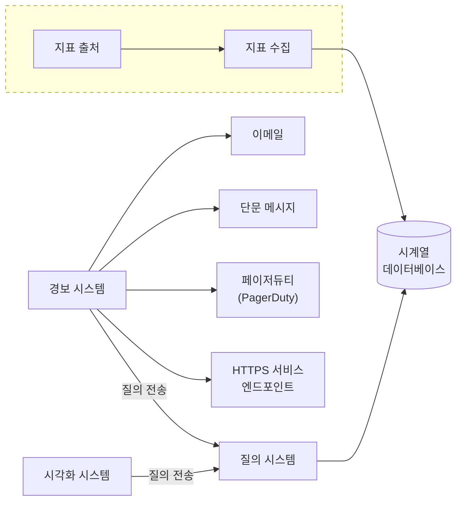
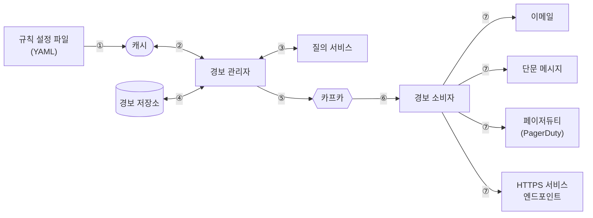
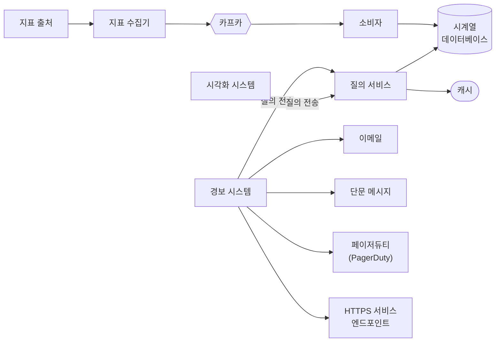

# 1단계

기능 요구사항
- 용도
	- 던저야할 질문
		- 인프라 지표냐?
		- 에러 모니터링이냐?
		- 액세스 모니터링 이냐?
	- 시스템 운영 인프라 지표로 결정
- 사용범위
	- 던저야할 질문
		- 내부 솔루션이냐?
		- Sass 이냐?
	- 내부에서 사용할 시스템
- 지표
	- 어떤 지표를 수집하는가?
		- 시스템 운영지표
			- CPU 부하
			- 메모리 사용률
			- 디스크 사용량 등등
		- 사업 지표는 도서내용에서는 제외
- 규모
	- 일간 능동 사용자 수 1억명
	- 1000개의 서버풀이 있음
	- 풀마다 100개의 서버 하드웨어 유지
- 보관기간
	- 최대 1년 동안 보관
- 보관방법
	- 7일 동안 보관
	- 7일 뒤 1분단위 데이터로 만들어 30일간 보관
	- 그 이상은 1시간 단위 데이터로 변환하여 보관
- 알림방법
	- 이메일, 전화, 페이저듀티, 웹훅 등을 지원
- 그외 체크
비기능 요구사항
- 규모확장성
- 낮은 응답 지연
- 안정성
- 유연성

고려하지 않아도 되는 사항
- 로그 모니터링
- 분산시스템 추적


# 2단계

시스템의 다섯 컴포넌트
- 데이터 수집
- 데이터 전송
- 데이터 저장소
- 경보
	- 밀려오는 데이터를 분석하고, 이상 징후를 감지하고, 경보를 발생 시킨다.
- 시각화
데이터모델
 - 시계열 데이터
	- 통상 시계열 데이터 형태로 기록한다
		- 값 집합에 타임스탬프가 붙은 형태
		- 시계열 각각에는 고유한 이름이 붙거, 선택적으로 레이블(label)이 붙기도 한다.
- 사례 1
	- 단순 버전
	- 데이터 모델 — 표 5.1 테이블로 표현한 데이터

		```mermaid
		block-beta
		  columns 2
		  h1["필드"] h2["값"]
		  k1["metric_name"] v1["cpu.load"]
		  k2["labels"] v2["host:i631,env:prod"]
		  k3["timestamp"] v3["1613707265"]
		  k4["value"] v4["0.29"]
		  classDef head fill:#e0e0e0,stroke:#888,font-weight:bold
		  class h1,h2 head
		```

		- 지표 이름(metric name), 레이블(host:i631, env:prod), 특정 시각에 측정된 지표 값으로 구성된다.
- 사례 2
	- 값 형태
		- 질문: 지난 10분간 us-west 지역에 위치한 모든 웹 서버의 CPU 부하 평균값은?
			- 지표 이름이 `CPU.load`이고 레이블의 지역 이름이 `us-west`인 데이터를 가져와 각 행 마지막 값(CPU 부하 수치)의 평균을 구한다.
			- 각 행은 행 프로토콜(line protocol) 형식 — 프로메테우스, OpenTSDB 등 많은 모니터링 SW가 준수하는 공통 형식

		```text
		CPU.load host=webserver01,region=us-west 1613707265 50
		CPU.load host=webserver01,region=us-west 1613707265 62
		CPU.load host=webserver02,region=us-west 1613707265 43
		CPU.load host=webserver02,region=us-west 1613707265 53
		...
		CPU.load host=webserver01,region=us-west 1613707265 76
		CPU.load host=webserver01,region=us-west 1613707265 83
		```

		- 데이터 모델 — 표 5.2 시계열 데이터

			```mermaid
			block-beta
			  columns 2
			  h1["이름"] h2["자료형"]
			  k1["지표 이름"] v1["문자열"]
			  k2["태그/레이블 집합"] v2["#lt;키:값#gt; 쌍의 리스트(List)"]
			  k3["지표 값 및 그 타임스탬프의 배열"] v3["#lt;값, 타임스탬프#gt; 쌍의 배열(Array)"]
			  classDef head fill:#e0e0e0,stroke:#888,font-weight:bold
			  class h1,h2 head
			```

	- 데이터 접근 패턴
		- 쓰기 부하가 막대하다
		- 읽기 부하는 일시적으로 치 솟았다 사라진다
		- 시각화와 경보 서비스는 데이터베이스에 대한 읽기 연산을 발생시킨다
		- 그래프나 경보를 확인하는 패턴에 따라 읽기 연산은 일시적으로 늘어났다 잠잠해 질 수 있다
	- 데이터 저장소 시스템
		- 범용 데이터 베이스는 이론적으로는 시계열 데이터를 처리할 수 있다
			- 하지만 
				- 이번 설계가 감당하려는 규모에 맞추려면 전문가 수준의 튜닝이 필요하다.
				- 시계열 데이터를 대상으로 통상적으로 수행하는 연산에 최적화 되어 있지 않다.
		- 
개략적 설계안

> 그림 5.7 지표 수집 흐름




# 3단계

지표 수집
- 카운터나 CPU 사용량 같은 지표를 수집할 때는 때로 데이터가 소실 되어도 아주 심각한 문제는 아니다. 지표를 보내는 클라이언트는 데이터가 전송 되었는지 신경 쓰지 않아도 된다.
	- 지표 데이터 수집 방법에는 두가지 모델이 있다.
		- 풀
			> 그림 5.8 풀 모델

			```mermaid
			flowchart RL
			  subgraph Sources[지표 출처]
			    Web[웹 서버]
			    DBC[DB 클러스터]
			    MQC[큐 클러스터]
			    CacheC[캐시 클러스터]
			  end
			  subgraph SDS[서비스 탐색 서비스]
			    Etcd[etcd]
			    ZK[주키퍼]
			  end
			  Collector[지표 수집기]
			  Collector -->|"지표 수집(Pull)"| Web
			  Collector -->|"지표 수집(Pull)"| DBC
			  Collector -->|"지표 수집(Pull)"| MQC
			  Collector -->|"지표 수집(Pull)"| CacheC
			  Collector --> SDS
			  style Sources stroke-dasharray: 5 5
			```
			- 실행중인 애플리케이션에서 주기적으로 지표 데이터를 가져오는 지표 수집기
				- 지표수집기는 데이터를 가져올 서비스 목록을 알아야 한다
				- 모든 서비스 엔드포인트의 DNS/IP 정보를 담은 파일을 두면 가장 간단하다.
				- 하지만
					- 이 방안은 서버가 수시로 추가/삭제되는 대규모 운영환경에는 적용하기 어렵다.
					- 해결점
						- etcd나 아파치 주키퍼 같은 서비스 탐색 기술을 활용하면 이 문제는 해결할 수 있다.
						- 각 서비스는 자신의 가용성 관련 정보를 서비스 탐색 서비스에 기록하고, SDS 는 서비스 엔드포인트 목록에 변화가 생길 때마다 지표 수집기에 통보하는 것이다.
					- 흐름
						- 지표 수집기는 SDS 에서 서비스 엔드포인트 설정 메타데이터 목록을 가져온다.
						- 지표수집기는 사전에 합의된 HTTP 엔드포인트에서 지표 데이터를 가져온다.
						- 지표수집기는 서비스 엔드포인트 목록의 변화를 통지받기 위한 변경 이벤트 알림 콜백을 서비스 탐색 컴포넌트에 등록 할 수 있다.
							- 주기적으로 서비스 탐색 컴포넌트에서 엔드포인트 목록을 다시 가져와도 된다.
					- 서버 풀
						- 지표수집기 서버 풀을 만들어야 본 설계안에서 다루는 데이터 규모를 감당할 수 있다.
							- 지표 수집 서버간에 모종의 중재 매커니즘이 존재 - 데이터 중복 전송을 막기위한
								- 안정 해시링 활용
									- 해시 링 구간마다 해당 구간에 속한 서버로 부터 생산되는 지표의 수집을 담당하는 수집기 서버를 지정

			> 그림 5.11 안정 해시 — 해시 링을 시계 방향으로 펼쳐 그림. 서버(S1~S6)는 시계 방향으로 처음 만나는 수집기가 담당한다.

			```mermaid
			flowchart TB
			  subgraph R2["구간 1 · 수집기 2 담당"]
			    direction LR
			    S1((S1)) --> S5((S5)) --> C2[수집기 2]
			  end
			  subgraph R3["구간 2 · 수집기 3 담당"]
			    direction LR
			    S2((S2)) --> S4((S4)) --> C3[수집기 3]
			  end
			  subgraph R4["구간 3 · 수집기 4 담당"]
			    direction LR
			    S3((S3)) --> C4[수집기 4]
			  end
			  subgraph R1["구간 4 · 수집기 1 담당"]
			    direction LR
			    S6((S6)) --> C1[수집기 1]
			  end
			  R2 --> R3 --> R4 --> R1
			  R1 -.->|링 한 바퀴| R2
			  style R2 fill:#ddd,stroke:#555
			```
		- 푸시
			> 그림 5.12 푸시 모델

			```mermaid
			flowchart LR
			  subgraph Sources[지표 출처]
			    Web[웹 서버]
			    DBC[DB 클러스터]
			    MQC[큐 클러스터]
			    CacheC[캐시 클러스터]
			  end
			  Collector[지표 수집기]
			  Web -->|지표 전송| Collector
			  DBC -->|지표 전송| Collector
			  MQC -->|지표 전송| Collector
			  CacheC -->|지표 전송| Collector
			  style Sources stroke-dasharray: 5 5
			```
			- 웹서버나 데이터베이스 서버 같은 서버가 직접 지표 수집기에 전송하는 모델
				- 수집 에이전트
					- 모니터링 대상 서버에 수집 에이전트라고 불리는 소프트웨어를 설치한다
						- 수집 에이전트는 해당 장비에서 실행되는 서비스가 생산하는 지표 데이터를 받아 모은 다음 주기적으로 수집기에 전달한다
						- 수집기에 보내기 전에 에이전트가 직접 데이터 집계 등의 작업을 처리할 수도 있다.
							- 데이터 집계
								- 수집기에 보내는 데이터의 양을 줄이는 효과적인 방법이다.
								- 규모 버퍼에 데이터를 일시적으로 보관한 다음 나중에 재전송 할 수도 있다.
									- 하지만
										- 모니터링 대상 서버의 클러스터가 자동 규모 확장이 가능하도록 설정되어있따면, 서버가 동적으로 추가되거나 삭제되는 과정에서 데이터 소실이 일어날 수도 있다.
											- 해결점
												- 지표수집기 클러스터 자체도 자동 규모 확장이 가능하도록 구성하고 그 앞에 로드밸런서를 두는 것이 바람직 하다

			> 그림 5.13 로드밸런서 및 지표 수집기 클러스터의 자동 규모 확장

			```mermaid
			flowchart LR
			  subgraph Sources[지표 출처]
			    direction LR
			    Web[웹 서버]
			    subgraph Agent[수집 에이전트]
			      M1[지표 1]
			      M2[지표 2]
			      M3[지표 3]
			    end
			    Web --> Agent
			  end
			  Agent -->|메시지 전송| LB[로드밸런서]
			  LB --> Cluster[["지표 수집기<br/>서버 클러스터<br/>(자동 규모 확장)"]]
			  style Sources stroke-dasharray: 5 5
			  style Agent stroke-dasharray: 5 5
			```

> 표 5.3 풀 vs 푸시 모델

| 항목 | 풀 모델 | 푸시 모델 |
|---|---|---|
| 손쉬운 디버깅 | 애플리케이션 서버에 `/metrics` 엔드포인트를 두도록 강제하므로 언제든 지표를 볼 수 있다(랩톱에서도). **풀 모델이 낫다** | |
| 상태 진단 (health check) | 서버가 풀 요청에 응답하지 않으면 바로 장애로 진단할 수 있다. **풀 모델이 쉽다** | 지표를 받지 못하면 네트워크 장애인지 서버 장애인지 알기 어렵다 |
| 생존 기간이 짧은 프로세스 | (푸시 게이트웨이를 도입하면 해결 가능) | 수집기가 끌어가기 전에 일괄 작업 프로세스가 종료될 수 있다. **푸시 모델이 낫다** |
| 방화벽 등 복잡한 네트워크 구성 | 모든 `/metrics` 엔드포인트가 접근 가능해야 한다. 데이터센터가 여럿이면 문제가 될 수 있다 | 수집기가 로드밸런서 + 자동 규모 확장 클러스터라면 어디서 오는 지표든 수집 가능. **푸시 모델이 낫다** |
| 성능 | 일반적으로 TCP | 보통 UDP → 전송 지연이 더 낮다 (반론: TCP 연결 오버헤드는 지표 전송량에 비해 작다) |
| 데이터 신빙성 | 수집 대상 서버 목록이 미리 정의되어 있어 믿을 수 있다 | 아무나 데이터를 보낼 수 있다 → 허용 서버 목록 유지 또는 인증으로 해결 |

- 대표 사례: 풀 = 프로메테우스 / 푸시 = 아마존 클라우드워치, 그래파이트
- 정답은 없다. 면접에서는 두 모델의 장단점을 비교할 수 있는 능력이 더 중요하다.

지표 전송 파이프라인의 규모확장
- 지표수집기는 서버 클러스터 형태이며 엄청난 양의 데이터를 받아 처리해야 한다.
	- 클러스터는 자동으로 규모확장이 가능하도록 설정해야한다.
		- 하지만
			- 시계열 데이터베이스에 장애가 생기면 데이터 손실이 발생할 가능성이 있다.
				- 해결점
					- 큐를 두면 이런 문제를 해소할 수 있다.
						- 지표수집기 -> 카프카(큐 시스템/스트림 처리 서비스) 데이터 전송
						- 카프카
							- 고도로 안정적이고 규모 확장성이 뛰어난 분산 메시지 플래솜
							- 데이터 수집 컴포넌트와 처리 컴포넌트 사이의 결합도를 낮춤
							- 데이터베이스에 장애가 생겨도 데이터는 소실되지 않는다.
				- 카프카를 통한 규모확장
					- 카프카에 내장된 파티션 매커니즘 사용
						- 대역폭 요구사항에 따라 파티션의 수를 설정하낟.
						- 지표 이름에 따라 어떤 지표를 어느 파티션에 배치할지 결정하면 소비자는 지표이름에 따라 데이터를 집계할 수 있다.
						- 태그/레이블에 따라 지표 데이터를 더욱 세분화한 파티션으로 나눈다
						- 중요 지표가 먼저 처리될 수 있도록 지표를 분류하고 우선순위를 지정한다.
					- 카프카의 대안
						- 큐 없이도 대규모 처리가 가능한 모니터링 시스템
							- 고릴라 - 시계열 데이터베이스 시스템 
데이터 집계 지점
- 다양한 지점에서 실행 가능하다.
	- 수집 에이전트
		- 어떤 카운터 값을 분 단위로 집계하여 지표 수집기에 보내는 정도는 가능하다.
	- 데이터 수집 파이프라인
		- 데이터를 저장소에 기록하기 전에 집계할 수 있으려면
			- 플링크 같은 스트림 프로세싱 엔진이 필요하다.
				- 데이터베이스는 계산 결과만 기록하므로 실제로 기록되는 양은 엄청나게 줄어든다.
				- 하지만
					- 늦게 도착하는 지표 데이터의 처리가 어렵다
					- 원본 데이터를 보관하지 않기 때문에 정밀도나 유연성 측면에서 손해를 보게 된다
	- 질의 시점
		- 데이터를 날 것 그대로 보관한 다음 질의할 때 필요한 시간 구간에 맞게 집계한다
		- 하지만
			- 전체 데이터 세트를 대상으로 집계결과를 계산해야 하므로 속도는 느릴것이다.
질의 서비스
- 질의 서버 클러스터 형태로 구현되며, 시각화 또는 경보 시스템에서 접수된 요청을 시계열 데이터베이스를 통해 처리하는 역할을 담당한다.
	- 장점
		- 시각화/경보시스템 같은 클라이언트와 시계열 데이터베이스 사이의 결합도를 낮출 수 있다.
	- 캐시계층
		- 질의 결과를 저장할 캐시 서버를 도입하면 시계열 데이터베이스에 대한 질의 부하를 낮추고 질의 서비스의 성능을 높일 수 있다.
	- 질의 서비스를 두면 곤란한 경우
		- 상용화된 시각화/ 경보 시스템은 시장에 널리 알려진 시계열 데이터베이스와의 연동을 처리하는 강력한 플러그인을 갖추고 있는 경우가 많다.
			- 별도 캐시 계층이 필요 없는 경우도 있다.
	- 시계열 데이터 베이스의 질의어
		- 프로메테우스, InfluxDB 같은 너릴 사용되는 지표 모니터링 시스템은 SQL이 아닌 독자 질의어를 제공한다.
			- 시계열 데이터는 SQL로는 질의하기가 까다롭기 때문
				- 예: 지수 이동 평균(exponential moving average)을 SQL로 계산하는 경우
			```sql
			select id,
			       temp,
			       avg(temp) over (partition by group_nr order by time_read) as rolling_avg
			from (
			  select id,
			         temp,
			         time_read,
			         interval_group,
			         id - row_number() over (partition by interval_group order by time_read) as group_nr
			  from (
			    select id,
			           time_read,
			           'epoch'::timestamp + '900 seconds'::interval * (extract(epoch from time_read)::int4 / 900) as interval_group,
			           temp
			    from readings
			  ) t1
			) t2
			order by time_read;
			```
			- 하지만 시계열 데이터 베이스 분석에 최적화된 플럭스(Flux)라는 언어로 작성하면 다음과 같이 간단한 질의문이 만들어 진다.
			```flux
			from(db:"telegraf")
			  |> range(start:-1h)
			  |> filter(fn: (r) => r._measurement == "foo")
			  |> exponentialMovingAverage(size:-10s)
			```
			
저장소 계층
- 시계열 데이터베이스는 신중하게 선택할 것
	- 저장소에 대한 질의의 85% 는 지난 26시간 내에 수집된 데이터를 대상으로 한다.
	- 이 사실을 잘 활용하는 시계열 데이터베이스를 고르면 성능 측면에서 큰 이득을 볼 수 있다.
- 저장 용량 최적화
	- 지표 모니터링 시스템에 저장할 데이터의 양은 막대하다.
		- 해결점
			- 데이터 인코딩 및 압축
				- 예제
					- 이중-델타 인코딩
						- 대략 10초만큼만 다른 값이며,
						- 타임 스탬프 하나를 온전히 표현하는데는 32비트가 필요하지만 10을 표현하는데는 4비트면 충분하다.
							- 데이터를 완전한 형태로 저장하는 대신 기준값과의 차이를 1610087371, 10, 10, 9, 11 로 저장한다.

					> 그림 5.18 데이터 인코딩 (이중-델타 인코딩) — 인접한 타임스탬프끼리의 차이(Δ)만 저장한다.

					```mermaid
					flowchart TB
					  T1["1610087371<br/>(기준값)"]
					  T2["1610087381"]
					  T3["1610087391"]
					  T4["1610087400"]
					  T5["1610087411"]
					  D1(("Δ 10"))
					  D2(("Δ 10"))
					  D3(("Δ 9"))
					  D4(("Δ 11"))
					  T1 --> D1
					  T2 --> D1
					  T2 --> D2
					  T3 --> D2
					  T3 --> D3
					  T4 --> D3
					  T4 --> D4
					  T5 --> D4
					  Stored["저장 결과<br/>1610087371, 10, 10, 9, 11"]
					  T1 -.-> Stored
					  D1 & D2 & D3 & D4 -.-> Stored
					```

					> 타임스탬프 하나는 32비트지만 Δ(10 내외)는 4비트로 충분하다. 엄밀한 이중-델타(delta-of-delta)라면 델타끼리의 차이(0, -1, 2)를 한 번 더 저장해 더 줄인다.

			- 다운 샘플링
				- 데이터의 해상도를 낮추 저장소 요구량을 줄이는 기법이다.
					- 본 설계안에 요구된 데이터 보관 기간은 1년
						- 낡은 데이터는 해상도를 줄여도 된다.
						- 기간별로 보관 규칙을 지정
							- 7일 이내 데이터 - 샘플링을 적용하지 않는다
							- 30일 이내 데이터 - 1분 해상도로 낮춰 보관한다
							- 1년 이내 데이터 - 1시간 해상도로 낮춰 보관한다
					- 예시: 10초 해상도 데이터를 30초 해상도로 집계 → 아래 표 5.4, 5.5
			- 냉동 저장소
				- 냉동 저장소는 잘 사용되지 않는 비활성화 상태 데이터를 보관하는 곳이다.

> 표 5.4 10초 해상도 데이터 (다운 샘플링 전)

| 지표 | 타임스탬프 | 호스트명 | 지표 값 |
|---|---|---|---|
| cpu | 2021-10-24T19:00:00Z | host-a | 10 |
| cpu | 2021-10-24T19:00:10Z | host-a | 16 |
| cpu | 2021-10-24T19:00:20Z | host-a | 20 |
| cpu | 2021-10-24T19:00:30Z | host-a | 30 |
| cpu | 2021-10-24T19:00:40Z | host-a | 20 |
| cpu | 2021-10-24T19:00:50Z | host-a | 30 |

> 표 5.5 30초 해상도 데이터 (다운 샘플링 후)

| 지표 | 타임스탬프 | 호스트명 | 지표 값(avg) |
|---|---|---|---|
| cpu | 2021-10-24T19:00:00Z | host-a | 19 |
| cpu | 2021-10-24T19:00:30Z | host-a | 25 |

> [!note] 책의 값 검산
> 표 5.4를 30초 단위로 평균 내면 (10+16+20)/3 ≈ **15.3**, (30+20+30)/3 ≈ **26.7** 이다. 표 5.5의 19, 25는 책에 인쇄된 값을 그대로 옮긴 것이다(원서 표기 오류로 보임).

경보 시스템

> 그림 5.19 경보 시스템



| 순번 | 흐름 |
|---|---|
| ① | 규칙 설정 파일을 가져와 캐시 서버에 보관 |
| ② | 경보 관리자가 캐시에서 경보 설정 내역을 가져옴 |
| ③ | 지정된 주기마다 질의 서비스를 호출, 임계값 위반 시 경보 이벤트 생성 |
| ④ | 경보 상태(활성화·응답 대기·경보 발령·문제 해결)를 경보 저장소(카산드라 같은 키-값 저장소)에 기록·조회 |
| ⑤ | 경보 이벤트를 카프카에 전달 |
| ⑥ | 경보 소비자가 카프카에서 경보 이벤트를 읽음 |
| ⑦ | 이메일·단문 메시지·페이저듀티·HTTPS 엔드포인트 등 채널로 알림 전송 |

- 처리흐름
	- 설정파일을 가져와 캐시 서버에 보관한다.
		- 디스크에 파일 상태로 보관
		- YAML이 널리 사용된다.
	- 경보관리자는 경보 설정 내역을 캐시에서 가져온다
	- 지정된 시간마다 질의 서비스를 호출한다
		- 질의 결과가 설정된 임계값을 위반하면 경보 이벤트를 생성한다.
		- 그 외 작업
			- 경보 필터링, 병합, 중복제거
				- 짧은 시간동안 같은 인스턴스에서 발생한 경보는 1개의 경보 이벤트로 병합할 수 있다.
			- 접근제어
			- 재시도
	- 경보저장소는 카산드라 같은 형태의 키-값 저장소다
		- 모든 경보의 상태 활성화, 응답대기, 경보발령, 문제해결 등이 여기 보관된다.
	- 경보 이벤트를 카프카에 전달한다
	- 경보 소비자는 카프카에서 경보 이벤트를 읽는다
	- 경보 소비자는 카프카에서 읽은 경보 이벤트를 처리하여 이메일, 단문메시지, 페이저듀티 등드으이 다양한 채널로 알림을 전송한다.
시각화
- 데이터 계층 위에 만들어진다. 
	- 지표 대시보드에는 지표를 다양한 시간 범위로 표시하고, 
	- 경보 대시보드에는 다양한 경보와 상태를 표시한다.
		- 서버가 처리하고 있는 요청의 수
		- 메모리/CPU 사용률
		- 페이지 로드시간
		- 트래픽 양
		- 로그인 현황
최종설계안

> 그림 5.22 최종 설계안



> 그림 5.7(개략적 설계안) 대비 추가된 것: **카프카 + 소비자**(DB 장애 시 데이터 소실 방지, 규모 확장), **질의 서비스 앞단 캐시**(시계열 DB 질의 부하 감소)


