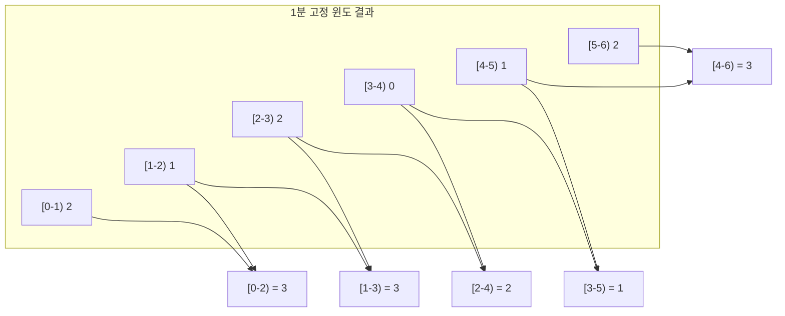
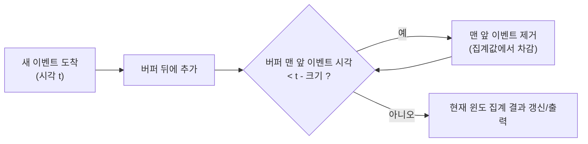
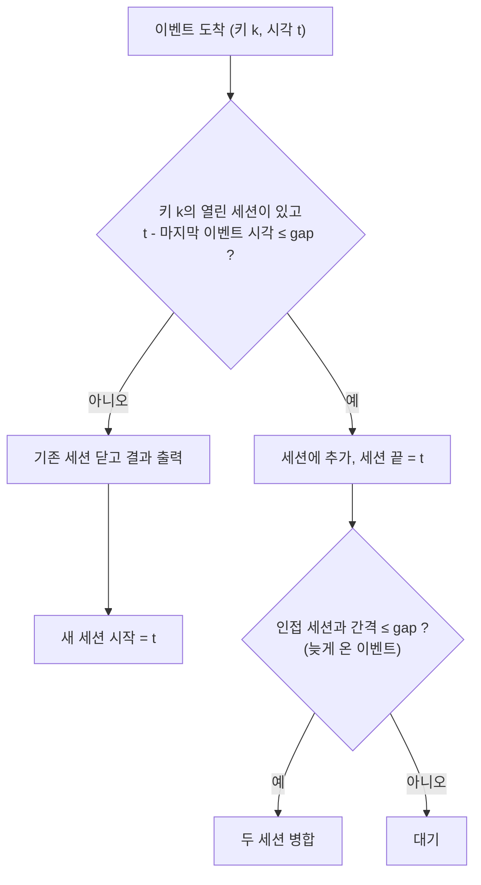
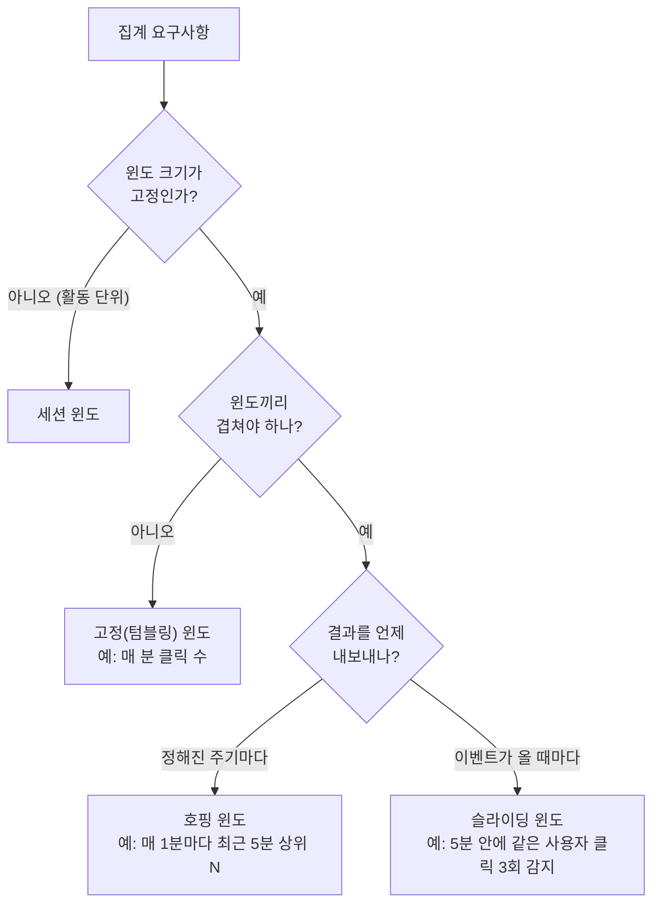

# 부록: 집계 윈도 알고리즘

> 본문: [정리](./정리.md) — 3단계 "집계윈도"
> 분류 기준: 마틴 클레프만 『데이터 중심 애플리케이션 설계』 11장 (스트림 처리)

## 0. 공통 예제

모든 그림은 **같은 이벤트 8개**(한 사용자의 광고 클릭)를 각 윈도 방식으로 묶었을 때의 결과다.
그림에서 ◆는 이벤트이고, 막대는 윈도이며, 막대 이름의 숫자는 그 윈도에 들어간 이벤트 수다.

| 이벤트 | e1 | e2 | e3 | e4 | e5 | e6 | e7 | e8 |
| --- | --- | --- | --- | --- | --- | --- | --- | --- |
| 발생 시각 | 0:20 | 0:50 | 1:30 | 2:10 | 2:20 | 4:40 | 5:00 | 5:30 |

```mermaid
gantt
    title 공통 예제 이벤트 (분:초)
    dateFormat X
    axisFormat %M:%S
    section 이벤트
    e1 :milestone, 20, 0s
    e2 :milestone, 50, 0s
    e3 :milestone, 90, 0s
    e4 :milestone, 130, 0s
    e5 :milestone, 140, 0s
    e6 :milestone, 280, 0s
    e7 :milestone, 300, 0s
    e8 :milestone, 330, 0s
```

## 한눈에 비교

| 구분 | 고정(텀블링) 윈도 | 호핑 윈도 | 슬라이딩 윈도 | 세션 윈도 |
| --- | --- | --- | --- | --- |
| 크기 | 고정 | 고정 | 고정 | **가변** (활동 기간에 따라) |
| 경계 기준 | 시계(시각) 정렬 | 시계 정렬, hop 간격으로 시작 | **이벤트 시각** 기준 | 비활동 간격(gap) |
| 겹침 | 없음 | 있음 | 있음 | 없음 (키별) |
| 이벤트 1개가 속하는 윈도 수 | 정확히 1개 | 크기 ÷ hop 개 | 여러 개 | 정확히 1개 |
| 파라미터 | 크기 | 크기, hop | 크기 | gap |
| 대표 용도 | 분 단위 클릭 수 집계 | 이동 평균, 최근 N분 지표를 주기적으로 | 최근 N분 안의 정확한 이벤트 관계 | 사용자 세션 분석, 체류 시간 |

## 1. 고정 윈도 (Tumbling / Fixed Window)

- 시간을 **같은 크기로, 겹치지 않게** 자른다.
- 모든 이벤트는 정확히 하나의 윈도에만 속한다. → 구현이 가장 단순하고 상태도 윈도 1개분만 유지하면 된다.
- 윈도 결정 방법: `윈도 시작 = floor(이벤트 시각 / 크기) × 크기`
	- 예: 크기 1분, 이벤트 2:10 → 윈도 [2:00, 3:00)
- 광고 클릭 설계에서는 **요구사항 1(매 분 클릭 수 집계)** 에 쓴다.

```mermaid
gantt
    title 고정 윈도 (크기 1분)
    dateFormat X
    axisFormat %M:%S
    section 이벤트
    e1 :milestone, 20, 0s
    e2 :milestone, 50, 0s
    e3 :milestone, 90, 0s
    e4 :milestone, 130, 0s
    e5 :milestone, 140, 0s
    e6 :milestone, 280, 0s
    e7 :milestone, 300, 0s
    e8 :milestone, 330, 0s
    section 윈도
    [0-1분) 2개 e1 e2 :0, 60s
    [1-2분) 1개 e3 :60, 60s
    [2-3분) 2개 e4 e5 :120, 60s
    [3-4분) 0개 :done, 180, 60s
    [4-5분) 1개 e6 :240, 60s
    [5-6분) 2개 e7 e8 :300, 60s
```

## 2. 호핑 윈도 (Hopping Window)

- 크기는 고정이지만 **hop(이동 간격) < 크기**라서 윈도끼리 겹친다.
- 이벤트 하나가 `크기 ÷ hop`개의 윈도에 동시에 들어간다.
- 구현 방법 1: 크기가 hop인 고정 윈도로 먼저 집계하고, 인접한 여러 개를 합친다.
	- 예: 크기 2분, hop 1분 → 1분 고정 윈도 결과 2개씩 합산
- hop = 크기이면 고정 윈도와 같다.
- 참고: 플링크(Flink)는 이것을 "sliding window"라고 부른다. 책 그림 6.16(3분 길이, 1분 단위로 이동)도 엄밀히는 호핑 윈도다.

```mermaid
gantt
    title 호핑 윈도 (크기 2분, hop 1분)
    dateFormat X
    axisFormat %M:%S
    section 이벤트
    e1 :milestone, 20, 0s
    e2 :milestone, 50, 0s
    e3 :milestone, 90, 0s
    e4 :milestone, 130, 0s
    e5 :milestone, 140, 0s
    e6 :milestone, 280, 0s
    e7 :milestone, 300, 0s
    e8 :milestone, 330, 0s
    section 윈도
    [0-2분) 3개 e1 e2 e3 :0, 120s
    [1-3분) 3개 e3 e4 e5 :60, 120s
    [2-4분) 2개 e4 e5 :120, 120s
    [3-5분) 1개 e6 :180, 120s
    [4-6분) 3개 e6 e7 e8 :240, 120s
```

## 3. 슬라이딩 윈도 (Sliding Window)

- 윈도 경계가 시계에 맞춰져 있지 않고 **이벤트 시각을 기준으로 계속 미끄러진다**.
- 클레프만의 정의: 서로 일정 간격(크기) 안에 있는 이벤트를 모두 같은 윈도에 넣는다.
	- 예: 크기 5분이면 10:03:39와 10:08:12는 같은 윈도에 들어간다. 고정 윈도라면 10:00~10:05와 10:05~10:10으로 갈라진다.
- 구현: 시간순으로 정렬된 버퍼(큐)를 두고, 새 이벤트가 오면 넣고 크기를 벗어난 오래된 이벤트는 앞에서 뺀다.
	- 그래서 윈도 내용이 바뀌는 시점(이벤트 도착이나 만료)마다 결과가 갱신된다. (Kafka Streams의 sliding window 방식)
- 호핑 윈도와의 차이: 호핑은 정해진 시각(매 1분 정각)에만 윈도가 시작하고, 슬라이딩은 **모든 이벤트 시점**이 윈도의 끝이 될 수 있다.
- 광고 클릭 설계에서는 **요구사항 2(지난 M분간 상위 N개 광고)** 에 대응한다.

```mermaid
gantt
    title 슬라이딩 윈도 (크기 2분, 각 이벤트 시점에서 직전 2분)
    dateFormat X
    axisFormat %M:%S
    section 이벤트
    e1 :milestone, 20, 0s
    e2 :milestone, 50, 0s
    e3 :milestone, 90, 0s
    e4 :milestone, 130, 0s
    e5 :milestone, 140, 0s
    e6 :milestone, 280, 0s
    e7 :milestone, 300, 0s
    e8 :milestone, 330, 0s
    section 윈도 (끝 = 이벤트)
    e4까지 4개 e1~e4 :10, 120s
    e5까지 5개 e1~e5 :20, 120s
    e6까지 1개 e6 :160, 120s
    e7까지 2개 e6 e7 :180, 120s
    e8까지 3개 e6~e8 :210, 120s
```

## 4. 세션 윈도 (Session Window)

- **고정된 크기가 없다.** 같은 키(사용자, 광고 ID 등)의 이벤트가 이어지는 동안 윈도가 늘어나고, **비활동 간격(gap)** 동안 이벤트가 없으면 닫힌다.
- 윈도는 키마다 따로 관리되며, 같은 키 안에서는 겹치지 않는다.
- 동작 규칙
	- 이전 이벤트와의 간격 ≤ gap이면 같은 세션으로 확장한다.
	- 간격 > gap이면 이전 세션을 닫고 새 세션을 시작한다.
	- 늦게 도착한 이벤트가 두 세션 사이의 빈틈을 메우면 **두 세션을 병합**한다. (구현이 가장 까다로운 부분)
- 대표 용도: 웹사이트 방문 세션 분석, 사용자 체류 시간, 한 세션당 클릭 수

```mermaid
gantt
    title 세션 윈도 (gap 1분)
    dateFormat X
    axisFormat %M:%S
    section 이벤트
    e1 :milestone, 20, 0s
    e2 :milestone, 50, 0s
    e3 :milestone, 90, 0s
    e4 :milestone, 130, 0s
    e5 :milestone, 140, 0s
    e6 :milestone, 280, 0s
    e7 :milestone, 300, 0s
    e8 :milestone, 330, 0s
    section 세션 1
    세션 1 5개 e1~e5 :20, 120s
    gap 대기 후 종료 :done, 140, 60s
    section 세션 2
    세션 2 3개 e6~e8 :280, 50s
    gap 대기 후 종료 :done, 330, 60s
```

## 5. 어떤 윈도를 고를까

